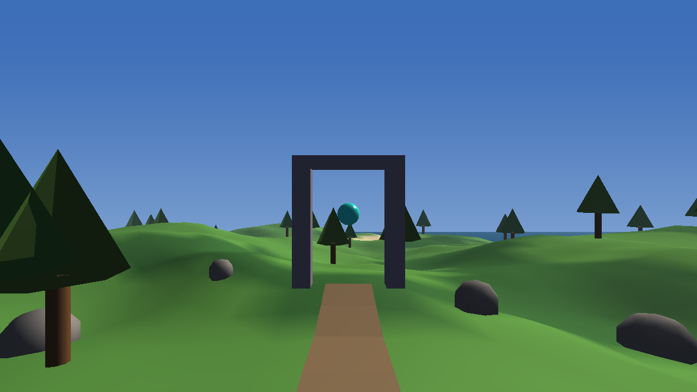
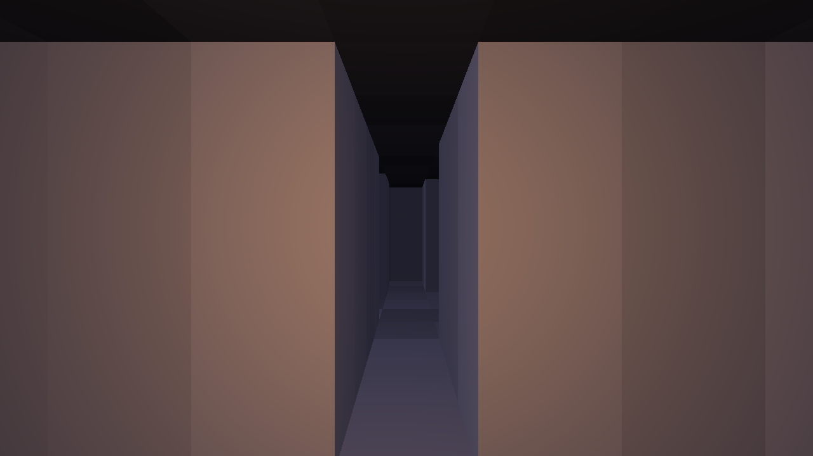
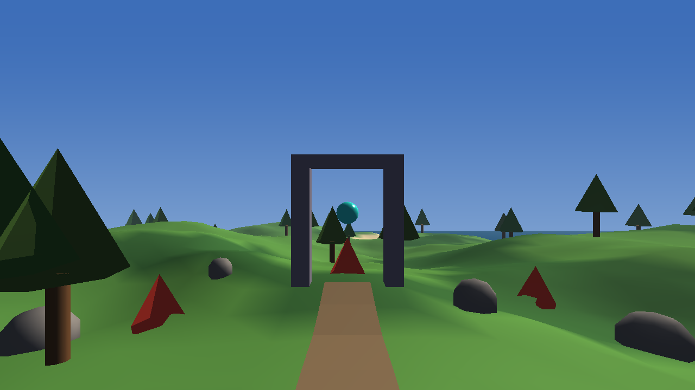
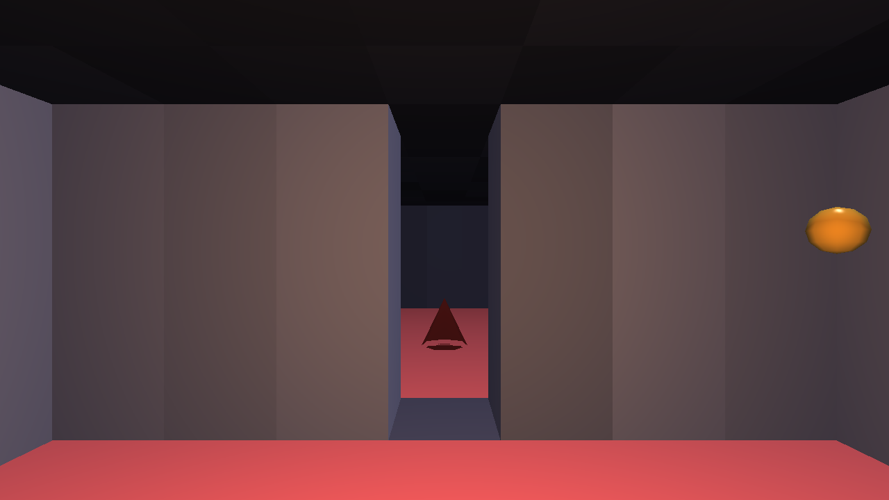
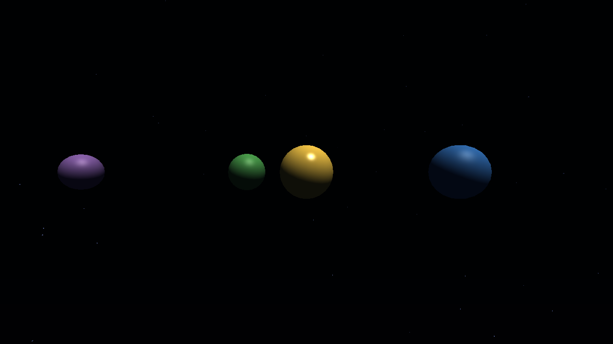
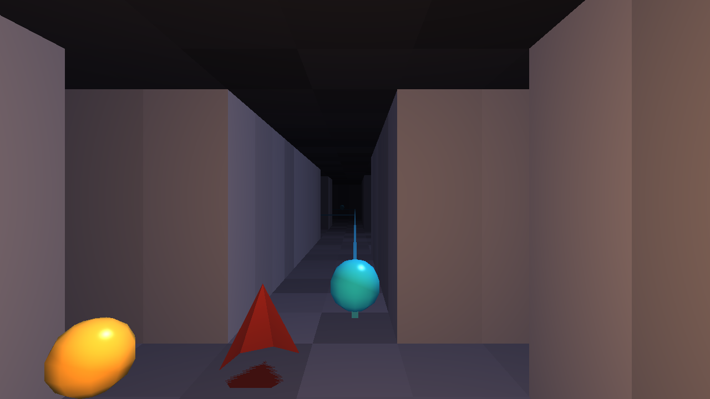
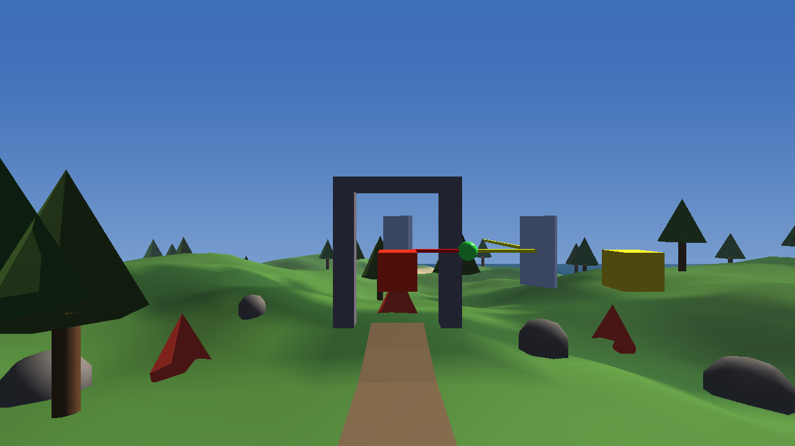

# Keystone

[](https://github.com/AegeanWorks/AIKit)



> **Architecture status (v0.7.0):** This is a playable vertical slice, not the final core boundary. Combat, light locks, weave layouts, networks and space are game examples, not engine mechanics. Genre feature work is frozen pending review of [`docs/ARCHITECTURE.md`](docs/ARCHITECTURE.md); the next work is the core/module split, not another game module.

A performance-first 3D game engine in Python with an OpenGL 3.3 renderer, deterministic procedural worlds, first-person collision, survivors-style combat, light-routing puzzles, cyber-network infiltration, a free-flight space survey mode and a headless AI harness.

Keystone's core loop is a **seeded expedition**: one integer seed generates an island, a dungeon, a light lock and a cyber network. The player walks the terrain, fights escalating enemy waves, turns mirrors to open the crypt portal, hacks network terminals while avoiding NetWatch hunters, explores a generated room layout, and returns to the surface. A second mode launches a free-flight ship into a seeded galaxy of orbiting bodies, scan surveys and hyperlane gates. The authoritative simulation is independent of OpenGL, so the same run can be rendered, replayed from JSON actions, or hashed for regression checks.

| Overworld | Dungeon |
|---|---|
|  |  |

## ⚡ 30-Second Cold-Start Quick Reference

- **Runtime Prerequisites**: Python 3.10+ with the pinned `requirements.txt` stack (numpy 2.5.3, PyOpenGL 3.1.10, glfw 2.11.0, pytest 9.1.1) and an OpenGL 3.3-capable GPU driver.
- **Install**: `python -m pip install -r requirements.txt`
- **Canonical Regression Shield Gate**:
  ```bash
  python -m pytest -q
  ```
- **Run the expedition**:
  ```bash
  python -m keystone
  ```
- **Run a specific seed**:
  ```bash
  python -m keystone --seed 42
  ```
- **Force a woven dungeon**:
  ```bash
  python -m keystone --seed 8 --layout weave
  ```
- **Launch the space survey mode**:
  ```bash
  python -m keystone --space
  ```
- **Original showcase scene**:
  ```bash
  python -m keystone --demo
  ```
- **Render headlessly**:
  ```bash
  python -m keystone --headless --frames 1 --size 1280x720 --out frame.png
  ```
- **Ask the AI harness for the action schema**:
  ```bash
  python -m keystone.harness catalog
  ```

### 🛠️ AIKit Commands (run from the AIKit folder)

| Role | Command |
|---|---|
| Status, task and gates | `python aikit.py status keystone` |
| Phase 4: every gate | `python aikit.py check keystone` |
| Repair memory and map, then check | `python aikit.py fix keystone` |
| Resume an interrupted task | `python aikit.py resume keystone` |

## 🎮 Controls

The window captures the mouse on start.

| Input | Action |
|---|---|
| `W` / `A` / `S` / `D` | Move forward / left / back / right |
| Mouse | Look around |
| Arrow keys | Look with the keyboard |
| `Shift` | Sprint |
| `E` | Turn a nearby light-lock mirror; enter the portal when the lock is solved; hack a network terminal; leave through the crypt exit when the network is complete |
| `F1` | Release or recapture the mouse |
| `Esc` | Close the window |

Weapons fire automatically at the nearest enemy in range. Keep moving to avoid contact damage; the window title shows HP, wave, kills and whether a boss is alive.

Space mode uses free flight: `W`/`S` forward/back, `A`/`D` strafe, `R`/`F` up/down, mouse/arrows to look, `Shift` to boost, `E` to scan a nearby body and `J` at the gate to jump.

## 🧭 The Core Loop

1. `World(seed)` generates the island heightfield, the dungeon layout and the combat director from the same seed.
2. The player starts at a walkable clearing, facing the stone portal, with the opening enemy pack in the forward arc.
3. Walking uses terrain height, water and slope checks; the dungeon uses a player-radius grid collision check.
4. Enemies chase, split, explode or soak damage; the weapon auto-fires, waves escalate and a Warlord arrives every fifth wave. Death respawns the player at the last safe point with a fresh arena.
5. The crypt portal is sealed by a light lock: an emitter, a green dye cell, two rotatable mirrors and a receiver. Turn the mirrors with `E` until the beam arrives with the exact target color; the receiver turns green and the portal opens.
6. Interacting at the open portal switches the world to `dungeon`, rebuilds the scene and respawns the arena around the dungeon spawn. Auto layout chooses the room-and-corridor crypt on odd seeds and the woven room chain on even seeds; `--layout crypt|weave` forces one.
7. The dungeon exit is sealed until the cyber network is compromised. Each terminal takes four `E` presses; every press raises the alert, and at 50+ alert NetWatch hunters spawn. Hack all terminals to unlock the exit.
8. Interacting at the unlocked exit rune restores the overworld position at the portal.
9. `World.state_hash()` fingerprints seed, time, player, terrain metadata, dungeon tiles, weave path, light-lock state, network state and combat state. Identical seeds and actions produce identical hashes.

The dungeon preview is generated from the same run: `assets/dungeon.png`.

## 🚀 Features

- **Deterministic simulation core**: `keystone/sim/` imports no OpenGL; a fixed-step world, seeded generation and a stable replay hash drive every view.
- **Procedural island**: deterministic integer-hash value noise and FBM, radial island falloff, water level, biome colors, a clearing and a path from spawn to portal.
- **Procedural dungeon**: seeded non-overlapping rooms, L-shaped corridors, farthest-room exit, symmetric-raycast field of view and BFS pathfinding.
- **First-person collision**: terrain walkability (water/slope), dungeon radius checks with axis-separated sliding, and portal/exit range transitions.
- **Survivors combat**: six seeded enemy archetypes (Crawler, Stalker, Bulwark, Splitter, Bomber, Warlord boss), auto-fire hitscan, contact damage, split-on-death, escalating waves, boss waves and death/respawn. The whole director is renderer-independent and included in the replay hash.
- **Light lock**: a seeded 2D beam circuit with additive red/green/blue color masks, `/` and `\` mirrors, a dye cell, a receiver, cycle-safe tracing and a portal gate. Mirrors rotate with `E`; the whole lock is renderer-independent and hashed.
- **Weave layout**: Weft-style Hamiltonian room chains. The generator visits every room exactly once, cuts the route into three colored threads and colors the 7×7 room floors by thread; every room is reachable and the exit is the final room.
- **Cyber network**: a seeded terminal graph in the dungeon with links, four-step hacks, rising alert, decaying heat, NetWatch hunter spawns at 50+ alert and a network-gated exit. Terminals and links are rendered in the scene and all state is hashed.
- **Space survey**: a seeded six-system galaxy, orbiting planets, free-flight movement, body scanning with credits and completion, a visible jump gate and hyperlane jumps. The mode is renderer-independent and has its own JSON harness.
- **GPU renderer**: OpenGL 3.3 core, GLSL 330, per-vertex colors, one directional light, an optional warm point light (the crypt torch), depth testing, culling, gradient sky and distance fog.
- **Static batching**: terrain is one mesh; trees, crowns, rocks and the path are merged into four meshes, so the expedition renders in roughly ten draw calls.
- **Day/night atmosphere**: sun elevation drives daylight, warm dawn tint, ambient light, sky/horizon colors and light intensity; the dungeon overrides with its own moody palette.
- **AI harness**: `catalog`, `run` and `selftest` JSON commands reproduce a run from a seed and an action list, with no GPU and no browser.
- **Headless parity**: the same renderer runs in a hidden context for tests and screenshots.

## ⚔️ Combat



Combat follows the Dustline model: the player only moves, the weapon auto-fires, and the pressure comes from wave composition and positioning. Enemies spawn around the player, chase across terrain or dungeon corridors, and deal contact damage. Crawlers are the baseline, Stalkers are fast, Bulwarks soak damage, Splitters spawn two Stalkers on death, Bombers explode on contact, and a Warlord boss arrives every fifth wave.

The director is seeded and lives in `keystone/combat.py`; it has no OpenGL dependency. Death resets the player to the last safe point with a fresh arena, so the AI harness can replay an entire run and still stop deterministically.

## 🧵 Weave Layout



`WeaveLayout` is a Weft-style Hamiltonian generator. It covers a 4×3 room grid exactly once, checks that the remaining cells stay connected while searching, then cuts the path into three colored threads. Each path cell becomes a 7×7 room, consecutive rooms are joined by corridors, and the room floor carries its thread color. The result is a guaranteed connected room chain from spawn to exit, with no unreachable room and no duplicate visit.

Even seeds select the weave in `auto` mode; odd seeds keep the room-and-corridor crypt. Force either with `--layout crypt` or `--layout weave`.

## 🚀 Space Survey



`--space` launches a second, self-contained mode: a six-system galaxy with orbiting stars, terrestrial/oceanic/desert/ice/gas-giant bodies, a starfield and a hyperlane gate. Fly with `WASD` + `R`/`F`, look with the mouse, and press `E` within sensor range of a body to survey it. Every survey awards credits and raises the system scan count; completing a system reports that the gate is ready. Fly within 12 units of the gate at `(0, 0, 60)` and press `J` to jump to a connected system. Scanned state persists across jumps.

Space has its own deterministic harness:

```bash
python -m keystone.space_harness catalog
python -m keystone.space_harness selftest
python -m keystone.space_harness run --seed 7 --actions actions.json
```

## 🕸️ Cyber Network



Each dungeon gets a seeded terminal graph. Four terminal rooms are selected from the reachable, non-spawn, non-exit rooms and connected by a deterministic link tree plus one extra link. Every terminal takes four `E` presses to compromise; each press raises the alert by 8 and the alert decays by 0.6/s. At 50+ alert, NetWatch spawns a hunter near the player. The exit rune stays sealed until every terminal is hacked, and the title reports `net n/4 alert N`.

Terminals are cyan until hacked and green afterward; links are drawn as thin conduits. The network snapshot is part of the world hash, so a scripted run can hack terminals and exit deterministically.

## 🔦 Light Lock



The portal circuit starts unsolved on every seed. A red emitter sends a beam east; the beam must pass through the green dye to become yellow, then reach the receiver with exactly the target mask. Two mirrors (`/` and `\`) redirect it. Standing within reach of a mirror and pressing `E` rotates it; the beam mesh and receiver color update immediately. The receiver turns green and the title reports `light open` when the lock is solved.

The tracer is cycle-safe: a mirror loop stops rather than spinning forever. `LightLock.snapshot()` is part of `World.snapshot()`, so mirror orientation, solved state and hash all replay identically.

## 🤖 Headless AI Harness

```bash
python -m keystone.harness catalog
python -m keystone.harness selftest
python -m keystone.harness run --seed 7 --actions actions.json --out run.json
```

`actions.json`:

```json
{
  "actions": [
    {"action": "turn", "yaw": 90},
    {"action": "move", "forward": 1.0, "seconds": 1.0, "sprint": true},
    {"action": "rotate"},
    {"action": "interact"},
    {"action": "wait", "seconds": 0.5}
  ]
}
```

The result contains the final state (`mode`, `player`, `terrain`, `dungeon`, `near_entrance`, `near_exit`, `light_lock`, `network`, `combat`, `events`) and a `hash`. The `rotate` action turns the nearest reachable mirror. The same seed and actions always produce the same hash; `selftest` proves determinism, seed sensitivity, portal entry, exit transition and rejection of unknown actions.

## 📈 Performance

- Frame loop after construction: roughly **2 ms per frame** at 1280×720 in a local headless run (AMD Radeon RX 9060 XT, OpenGL 3.3 core).
- 120 frames at 1280×720, including process startup, terrain/dungeon construction, combat and GLFW teardown: about **3–4 s wall-clock** locally. Construction and driver teardown dominate that number, not rendering.
- The static world is uploaded once; each frame updates the camera, atmosphere, enemy transforms and a handful of uniforms. Enemies are individual primitives; a hundred-plus would need instancing.

These are measurements of this demo on one machine, not a benchmark suite.

## 📦 What's Inside

```text
keystone/
├── keystone/
│   ├── __init__.py           <- package surface and version
│   ├── __main__.py           <- CLI: expedition, showcase, headless frames
│   ├── math3d.py             <- Vec3, Mat4, Quat (column-major, OpenGL-ready)
│   ├── camera.py             <- perspective camera and fly-style movement
│   ├── scene.py              <- hierarchy, transforms, lights, sky and fog
│   ├── geometry.py           <- indexed mesh data with optional vertex colors
│   ├── mesh_builder.py       <- merge boxes, quads and meshes into one MeshData
│   ├── primitives.py         <- cube, plane, cone, cylinder and UV sphere
│   ├── obj_loader.py         <- streaming Wavefront OBJ loader
│   ├── png.py                <- dependency-free PNG screenshot writer
│   ├── atmosphere.py         <- day/night sky, ambient and light model
│   ├── beams.py              <- light-lock tracer, mirrors, dye and receiver
│   ├── combat.py             <- archetypes, waves, auto-fire, boss, death
│   ├── expedition.py         <- world-to-scene assembly and player controls
│   ├── space.py              <- free-flight world, scans, survey and jumps
│   ├── space_expedition.py   <- space scene, starfield and ship controls
│   ├── space_harness.py      <- deterministic space JSON harness
│   ├── harness.py            <- deterministic JSON action harness
│   ├── app.py                <- engine loop, input and screenshot capture
│   ├── demo.py               <- original showcase scene
│   ├── procedural/
│   │   ├── __init__.py
│   │   ├── noise.py          <- deterministic value noise and FBM
│   │   ├── terrain.py        <- island heightfield, biome colors and mesh
│   │   ├── dungeon.py        <- rooms, corridors, FOV and BFS
│   │   ├── weave.py          <- Hamiltonian room chain and thread colors
│   │   ├── network.py        <- terminal graph, hacks and alert state
│   │   └── space.py          <- galaxies, systems, orbits and hyperlanes
│   ├── sim/
│   │   ├── __init__.py
│   │   └── world.py          <- deterministic state, collision, modes, hash
│   └── gpu/
│       ├── __init__.py       <- GPU adapter package marker
│       ├── context.py        <- GLFW window and OpenGL 3.3 context
│       ├── shader.py         <- GLSL compilation and uniform upload
│       ├── mesh_buffer.py    <- VAO/VBO/EBO upload and drawing
│       └── renderer.py       <- forward renderer, sky, lights, readback
├── assets/
│   ├── octahedron.obj        <- sample OBJ asset
│   ├── screenshot.png        <- showcase scene capture
│   ├── expedition.png        <- expedition overworld capture
│   ├── dungeon.png           <- generated crypt capture
│   ├── combat.png            <- enemy pack capture
│   ├── lightlock.png         <- portal light-lock capture
│   ├── weave.png             <- woven room capture
│   ├── network.png           <- dungeon terminal capture
│   └── space.png             <- space survey capture
├── tests/
│   ├── test_math3d.py        <- math core
│   ├── test_scene.py         <- hierarchy, camera and lights
│   ├── test_geometry.py      <- meshes, primitives, builder and OBJ
│   ├── test_png.py           <- PNG writer
│   ├── test_renderer.py      <- headless OpenGL integration
│   ├── test_procedural.py    <- noise, terrain and atmosphere
│   ├── test_dungeon.py       <- dungeon, FOV and pathfinding
│   ├── test_weave.py         <- Hamiltonian path, threads and dungeon
│   ├── test_network.py       <- terminals, links, hacks and alert
│   ├── test_beams.py         <- light lock, mirrors, dye and cycles
│   ├── test_space.py         <- galaxy, systems and orbits
│   ├── test_space_world.py   <- flight, scan, survey and jumps
│   ├── test_space_expedition.py <- space scene and controls
│   ├── test_space_harness.py <- space JSON harness
│   ├── test_combat.py        <- archetypes, waves, damage and boss
│   ├── test_world.py         <- deterministic state, movement and modes
│   ├── test_expedition.py    <- scene assembly and scene transitions
│   ├── test_harness.py       <- AI harness API and CLI
│   └── test_app.py           <- engine loop, demo and CLI
├── docs/
│   └── ARCHITECTURE.md       <- core/module boundary, GameModule contract and refactor plan
├── requirements.txt          <- pinned runtime and test dependencies
├── pyproject.toml            <- package metadata, pytest and ruff configuration
├── .gitignore                <- transient AIKit state excluded
├── LICENSE                   <- Aegean License 1.1 (AL-1.1): free personal use
├── COMMERCIAL.md             <- Commercial licensing terms
├── LICENSES/                 <- REUSE license texts
├── REUSE.toml                <- Machine-readable SPDX metadata
├── README.md
└── .aikit/                   <- this project's memory: record, ledger, decisions
```

### Frame flow

```text
Engine.run
  -> poll GLFW events and resize the framebuffer
  -> Expedition.handle_input: keyboard + captured mouse -> MoveIntent
  -> Expedition.update
       -> World.step: time, turn, collision, portal/exit interaction
       -> rebuild scene only when mode changes
       -> Atmosphere.at(day_fraction): sky, horizon, ambient, directional light
       -> camera follows the player eye
  -> Renderer.render
       -> sky pass (full-screen triangle, depth writes off)
       -> scene pass (terrain, water, batched trees/rocks/path, portal or crypt)
  -> swap buffers (visible window only)
```

## 🧩 Extending the Engine

Add a mesh to any scene with a transform and a material:

```python
from keystone.geometry import Material
from keystone.math3d import Vec3
from keystone.obj_loader import load_obj
from keystone.scene import Node, Scene, Transform

scene = Scene()
scene.camera.position = Vec3(0.0, 2.0, 6.0)
scene.camera.look_at(Vec3(0.0, 0.5, 0.0))
scene.add(
    Node(
        "artifact",
        Transform(position=Vec3(0.0, 0.8, 0.0), scale=Vec3(0.7, 0.7, 0.7)),
        mesh=load_obj("assets/octahedron.obj"),
        material=Material(color=Vec3(0.9, 0.7, 0.2), shininess=96.0),
    )
)
```

`MeshData` carries positions, normals, optional UVs, triangle indices and optional vertex colors; the GPU uploads it once and caches it by identity. `MeshBuilder` merges static geometry, which is how the 90 trees and the path become four draw calls.

## 🧬 Lineage & Licensing

Keystone's first implementation was built in this workspace. The seeded expedition deliberately reuses **algorithms and design patterns** from sibling AegeanWorks projects:

- **Aldervale** — integer-hash value noise/FBM, island heightfield, biome color palette, day/night atmosphere model, mesh-builder primitives.
- **Crypt-Crawler** — room-and-corridor generation, symmetric-raycast FOV, BFS pathfinding and the deterministic JSON harness pattern.
- **Dustline** — streaming-world collision ideas (circle/box separation and segment blocking), enemy archetype/wave/boss structure and combat pacing.
- **Iris** — color-mask light routing, mirror reflection, cycle-safe beam tracing and receiver validation.
- **Weft** — randomized Hamiltonian path with Warnsdorff ordering and connectivity checks, cut into colored thread segments and used as a guaranteed-coverage room chain.
- **Cyberpulse** — seeded terminal graphs, hack progress, alert tiers, NetWatch hunter response and the network-gated exit.
- **VoidFarer** — procedural star systems, orbiting celestial bodies, hyperlane connections and the scan/survey progression loop.

These were reimplemented as modular Python; no AGL-licensed assets or source files were copied into this repository. See ADR-006 for the provenance decision. Keystone itself remains under the Aegean License 1.1 (AL-1.1).

## 🗺️ Roadmap

1. Shadow maps and a second point light for the crypt.
2. PBR materials, textures and sRGB color management.
3. Weather (rain/snow particles) and a wind-driven foliage animation.
4. Weapons/upgrades, champion affixes and loot using the wider Dustline tables.
5. More light-lock chambers, lenses and movable emitters inside the crypt.
6. Weave loops, branches and thread-route puzzles inside the room chain.
7. Network puzzle variants (frequency/buffer/hash) and alert-driven terminal defenses.
8. Space combat, trade and multiple ships on top of the survey mode.
9. Save/load of the seed + action log, and a rewind/debug viewer.
10. glTF/scene import and an editor with gizmos.

## 🤖 AIKit Integration

- `.aikit/project.json` declares `mechanics.core` (simulation, terrain, dungeon, weave, network, beams, combat, expedition, space, renderer, harness) and `mechanics.test` (`python -m keystone.harness selftest`), so an agent exercises the same headless core.
- `.aikit/task_ledger.json` records plans, checkpoints and handoff state; resume with `python aikit.py resume keystone`.
- `.aikit/decisions.md` records ADR-001 through ADR-006.
- `python aikit.py check keystone` is the Phase 4 gate: tests, lint, mechanics, hygiene, guidelines and secret scan. It never pushes; delivery is opt-in.

## 📜 License

Free for personal use under the Aegean License 1.1 (AL-1.1); see [LICENSE](LICENSE). Any commercial use needs the Aegean Commercial License 1.0 (ACL-1.0); see [COMMERCIAL.md](COMMERCIAL.md).
