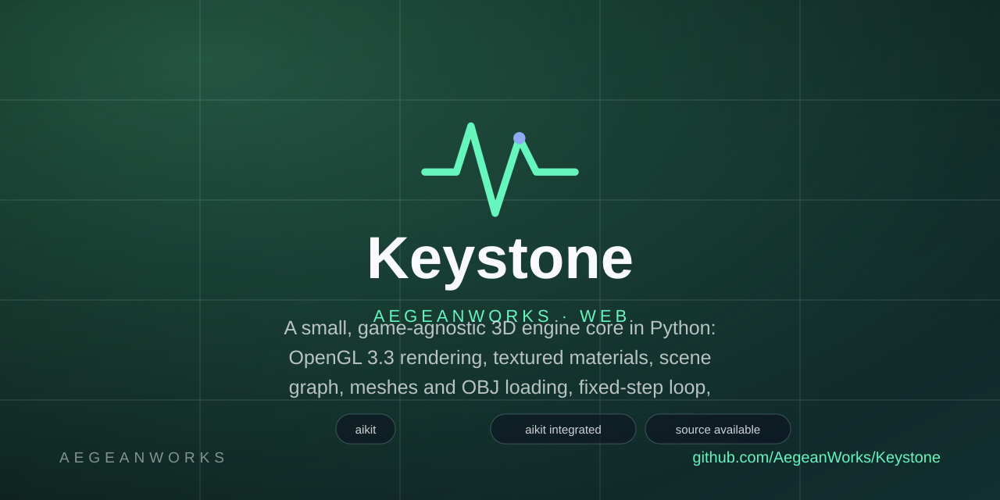
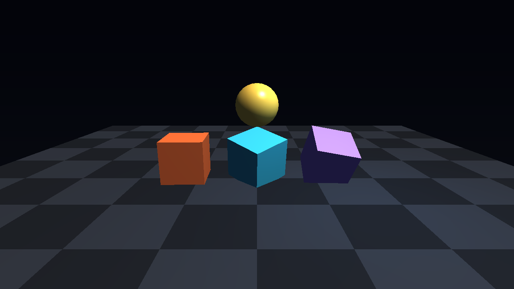
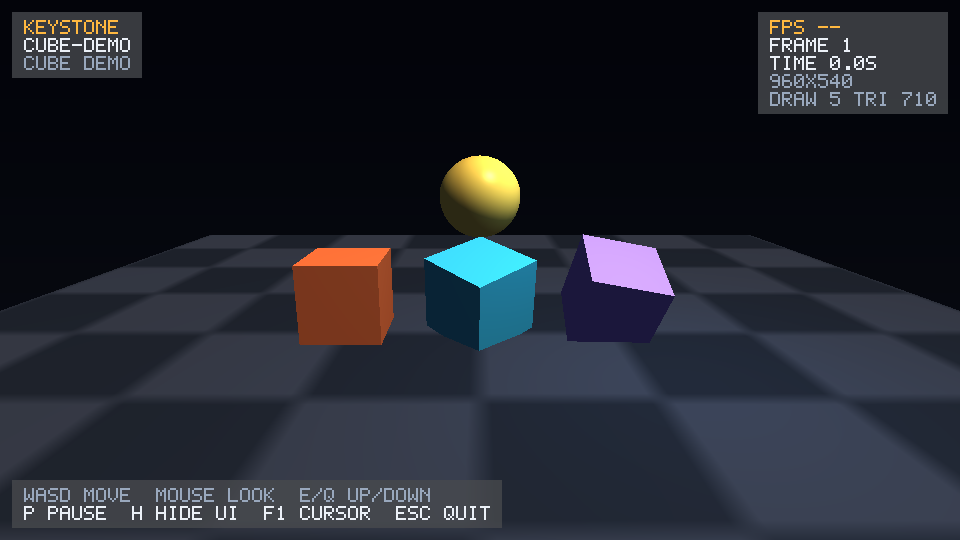
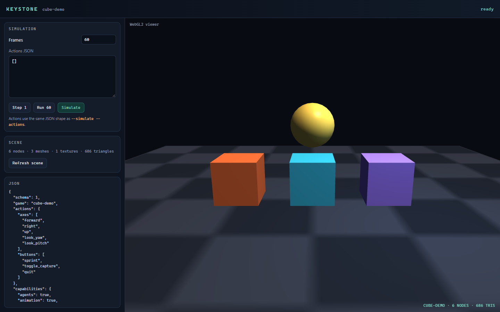

# Keystone

<!-- aegean:media:start -->
<p align="center"></p>
<p align="center"><a href="LICENSE"></a> <a href="https://github.com/AegeanWorks/AIKit"></a></p>
<!-- aegean:media:end -->




A small, game-agnostic 3D engine core in Python: OpenGL 3.3 PBR rendering, scene graph, meshes/OBJ, fixed-step loop, rebindable input, animation, particles, audio, collision, replay, atomic saves, batch planning/merging, and a HUD/profiler overlay with an embedded bitmap font.

Games plug in through one five-operation contract. Keystone ships a **cube demo** only as a smoke test; it contains no combat, puzzles, procedural worlds or other genre rules. External game modules live outside this package and load with `--game package.module:Factory`. Games may also add an optional `draw_ui(canvas, state)` hook for their own HUD.

## ⚡ 30-Second Cold-Start Quick Reference

- **Runtime Prerequisites**: Python 3.10+ with the pinned `requirements.txt` stack (numpy 2.5.3, PyOpenGL 3.1.10, glfw 2.11.0, pytest 9.1.1) and an OpenGL 3.3-capable GPU driver.
- **Install**: `python -m pip install -r requirements.txt`
- **Canonical Regression Shield Gate**:
  ```bash
  python -m pytest -q
  ```
- **Create and open a project**:
  ```bash
  python -m keystone --new my-game
  python -m keystone --project my-game
  ```
- **Open the local web console and WebGL viewer**:
  ```bash
  python -m keystone --serve
  ```
- **Hide or disable the human overlay**:
  ```bash
  python -m keystone --no-ui
  ```
- **Render headlessly with the HUD**:
  ```bash
  python -m keystone --headless --frames 1 --size 960x540 --ui --out hud.png
  ```
- **Discover a game from an AI client**:
  ```bash
  python -m keystone --describe
  ```
- **Verify a scenario is deterministic**:
  ```bash
  python -m keystone --verify-determinism --frames 120
  ```
- **Pin a known result**:
  ```bash
  python -m keystone --simulate --frames 120 --expect-hash <32-hex-hash>
  ```
- **Simulate without OpenGL**:
  ```bash
  python -m keystone --simulate --frames 120 --trace
  ```
- **Emit a model-readable frame report**:
  ```bash
  python -m keystone --headless --frames 1 --size 1280x720 --out frame.png --report frame.json
  ```
### 🛠️ AIKit Commands (run from the AIKit folder)

| Role | Command |
|---|---|
| Status, task and gates | `python aikit.py status keystone` |
| Phase 4: every gate | `python aikit.py check keystone` |
| Repair memory and map, then check | `python aikit.py fix keystone` |
| Resume an interrupted task | `python aikit.py resume keystone` |

## 🧩 GameModule Contract

A game is an object with a name and five operations:

```python
from keystone.input import ActionState
from keystone.scene import Node, Scene


class MyGame:
    name = "my-game"

    def build_scene(self) -> Scene:
        scene = Scene()
        scene.add(Node("cube"))
        return scene

    def update(self, dt: float, actions: ActionState) -> None:
        ...

    def snapshot(self) -> dict[str, object]:
        return {"time": 0.0}

    def actions(self) -> dict[str, object]:
        return {"axes": ["forward", "right", "up", "look_yaw", "look_pitch"]}

    def status(self) -> str:
        return "my game"
```

The engine owns the window, OpenGL context, renderer, fixed clock, input sampling and screenshots. The game owns its state, rules and scene contents. The engine never imports a game.

### Scene identity and components

A node carries a stable scene ID, tags, one layer and optional typed components:

```python
from dataclasses import dataclass

from keystone.scene import Node, Scene


@dataclass(frozen=True)
class Health:
    value: int


scene = Scene()
hero = scene.add(Node("hero", id="hero", tags={"player"}, layer="actors"))
hero.add_component(Health(100))

assert scene.find_by_id("hero") is hero
assert scene.query(tag="player", layer="actors") == [hero]
assert scene.query(component=Health) == [hero]
```

IDs are allocated per scene (`node-1`, `node-2`, ...) on attach or first traversal. An explicit `id` is kept, a duplicate is rejected, and reparenting preserves the ID. `tags` are a set of strings, `layer` is one string, and each node holds one component per type. Queries are linear scans over the scene; an index can be added when a real workload needs it.

### Physics: broadphase, characters and triggers

```python
from keystone.broadphase import SpatialGrid
from keystone.character import CharacterBody, CharacterController
from keystone.math3d import Vec3
from keystone.physics import AABB, Ray, raycast
from keystone.triggers import TriggerTracker, TriggerVolume

grid = SpatialGrid(cell_size=4.0)
wall = AABB(Vec3(0, 0, 0), Vec3(0.5, 2, 4))
grid.insert("wall", wall)
boxes = [grid.get(key) for key in grid.query(AABB(Vec3(0, 0, 0), Vec3(1, 1, 1)))]
controller = CharacterController()
body = controller.step(
    CharacterBody(Vec3(0, 1, 0)),
    Vec3(4, 0, 0),
    1 / 60,
    [box for box in boxes if box is not None],
)
events = TriggerTracker().update(body.box(), [TriggerVolume("door", AABB(Vec3(0, 1, 0), Vec3(1, 1, 1)))])
hit = raycast(Ray(Vec3(), Vec3(0, 0, 1)), [("wall", wall)])
```

`SpatialGrid` keeps a uniform grid of AABB proxies with exact overlaps in insertion order; `cell_size` trades speed, not correctness. `CharacterController` moves an AABB body with wish velocity, gravity, wall/floor response, stair step-up, slope-limited climb and platform carry; capsules and solvers excluded. `TriggerTracker` reports sorted `entered`/`exited` tuples and an immutable `active` set; `raycast()` returns the nearest hit with an optional filter.

### Optional game UI

A game may add a `draw_ui(canvas, state)` method. It is optional; the five required operations do not change.

```python
from keystone.ui import Canvas, HudState


def draw_ui(self, canvas: Canvas, state: HudState) -> None:
    canvas.rect(16, 96, 220, 44, (0.03, 0.04, 0.06, 0.7))
    canvas.text(28, 108, f"OBJECTS {len(self.objects)}", (0.92, 0.94, 0.97, 1.0))
```

The hook runs before the engine HUD and pause menu, so engine UI stays on top. It receives the current `Canvas` and `HudState`, so games use the same embedded font, clipping and pause state as the engine. Hiding the overlay (`H`) hides game UI too.

### Textures

```python
from keystone.geometry import Material
from keystone.math3d import Vec3
from keystone.texture import TextureData

material = Material(
    color=Vec3(1.0, 1.0, 1.0),
    texture=TextureData.from_png("assets/floor.png"),
)
```

`TextureData.from_png()` accepts the same 8-bit RGBA PNGs as the reader. `TextureData.checker(size, dark, light, cell)` builds a deterministic texture without a file. Textures use repeat wrapping, mipmaps and the mesh UVs; the renderer caches one GPU texture per immutable payload.

## 🕹️ Sample Controls

The bundled `CubeDemo` uses the generic action map; the overlay shows it at runtime:

| Input | Action |
|---|---|
| `W` / `S` | Forward / back |
| `A` / `D` | Left / right |
| `E` / `Q` | Up / down |
| Mouse | Look; click menu items while paused |
| Arrow keys | Keyboard look |
| `P` | Pause / resume; opens the menu and releases the cursor |
| `W` / `S` or `↑` / `↓` | Move the pause-menu selection |
| `Enter` | Confirm the selected pause-menu item |
| `H` | Hide / show the HUD and help |
| `F1` | Release / recapture the mouse |
| `Esc` | Quit |

Pausing stops `GameModule.update()` while the window, renderer and overlay stay responsive. The pause menu offers `Resume`, `Hide HUD` and `Quit`; the cursor is released while it is open so items can be clicked, and recaptured on resume. The overlay is presentation-only: it never mutates game state.

## 🖥️ Human UI

Windowed runs draw a HUD by default; `--no-ui` turns it off and `--ui` adds it to a headless capture:

```bash
python -m keystone --no-ui
python -m keystone --headless --frames 1 --size 960x540 --ui --out hud.png --report hud.json
python -m keystone --headless --frames 1 --size 960x540 --ui --start-paused \
  --out paused.png --report paused.json
```

`--start-paused` renders the pause menu immediately, which is useful for UI screenshots and AI UI reports.

The overlay contains:

- game name, game status, FPS, frame number, elapsed simulation time and resolution;
- a controls panel (`P` pause, `H` hide, `F1` cursor, `Esc` quit);
- an interactive pause menu with `Resume`, `Hide HUD` and `Quit`, navigable by keyboard or mouse;
- a centered pause banner.

`keystone.ui` is split into an embedded 5×7 font, a clipped screen-space `Canvas`, small panel/button widgets, a pure `PauseMenu` state machine and `HumanOverlay`; `keystone.gpu.ui_renderer` uploads the canvas as one alpha-blended draw call. A game's optional `draw_ui(canvas, state)` hook draws into the same canvas. A headless report that includes `--ui` measures the same pixels a person sees.

## 🌐 Web Console, JSON API and WebGL Viewer

```bash
python -m keystone --serve
python -m keystone --serve --port 8899 --game package.module:Factory
```

The console binds to `127.0.0.1:8000` by default and serves a browser dashboard plus the same AI-facing JSON used by the CLI. It uses only the Python standard library and vanilla JavaScript; there is no npm build, CDN or extra runtime dependency.

The dashboard can inspect the game contract, run the same action scripts as `--simulate`, refresh the live scene, and preview the exported scene in a WebGL2 viewer with textured materials, vertex colors, directional and point lights, fog and the sample checker floor. The browser viewer is an inspection approximation; the OpenGL renderer remains the pixel authority.

| Endpoint | Method | Purpose |
|---|---|---|
| `/api/health` | `GET` | server, game and schema versions |
| `/api/describe` | `GET` | the same discovery payload as `--describe`, including `capabilities.web` |
| `/api/scene` | `GET` | scene document schema 2: camera, lights, atmosphere, node identity, world matrices, shared meshes and RGBA textures |
| `/api/inspector` | `GET` | batch plan, merge, audio/anim/particles, assets |
| `/api/simulate` | `POST` | the same deterministic result as `--simulate`; body `{"frames": 60, "actions": [...], "step": 0.0167, "trace": false}` |
| `/api` | `GET` | endpoint and schema index |

The API sends CORS headers so a local AI client or frontend can call it directly. It is a local development surface, not an internet service: keep the default loopback host, and pass `--host 0.0.0.0` only when you want network exposure. The server never opens a GL context, and prefab writes stay inside the configured library.

`/api/scene` exports the game's `self.scene` when it has one, so a live simulation is visible immediately. A game without that attribute gets a fresh `build_scene()` result; put the scene on `self.scene` for live state.

## 🚀 Features

- **OpenGL 3.3 core renderer**: GLSL 330, indexed meshes, depth/culling, Blinn-Phong + PBR, shadows, sRGB, post grade, bloom diffusion and point sprites; profiler stats.
- **Scene graph**: nodes with stable IDs, tags, layers, typed components, local/world transforms, visibility, cycle-safe parenting, queries and cached GPU meshes.
- **Prefabs**: capture subtrees, persist versioned `.kprefab` files through the asset registry, and instantiate deterministic copies with explicit or scene IDs.
- **Assets**: immutable `MeshData` with optional UVs and vertex colors, cube/plane/cone/cylinder/sphere primitives, OBJ loading, and `TextureData` with PNG/checker sources.
- **Textured PBR materials**: `Material` keeps specular/shininess plus metallic, roughness and emissive; `Material.texture` samples RGBA with repeat wrapping and mipmaps; glTF PBR and emissive survive import; material graphs add `pbr`; one cached GPU texture per payload.
- **Fixed-step runtime**: `FixedStepClock` releases whole steps with a bounded catch-up budget; the headless path advances one step per frame for deterministic tests.
- **Action input**: `InputMap` maps keys and pointer motion to `forward`, `right`, `up`, `look_yaw`, `look_pitch`, `pressed` and `held` with rebindable bindings and named action contexts (`gameplay`, `menu`, custom) that save/load as JSON; no direct GLFW access.
- **Audio core**: dependency-free synth (`sine`, `square`, `noise`), named-bus `Mixer` with deterministic mixdown, mono 16-bit WAV IO and `audio_report()`; no hardware.
- **Animation core**: keyframe `Track`/`AnimationClip` (linear/step), looping controller, crossfade blending, timed events, `apply_pose()`, linear-blend skinning (CPU + GPU), JSON round trips and `animation_report()`.
- **Replay runner**: `run_log()`/`verify_log()` replay a `CommandLog` headlessly, and `--replay log.json` (with `--out`, `--expect-hash`, `--trace`) audits files.
- **Particles**: deterministic CPU `Emitter`/`ParticleSystem` (seeded spawn, gravity/drag, swept collision with bounce, friction and contact-kill, bursts, culling, JSON round trips, reports); HUD/inspector/describe counts; one GPU billboard per particle.
- **Physics**: ray/AABB/sphere queries, sphere pushout, spatial-grid broadphase, AABB character movement with gravity and ground detection, trigger tracking and filtered raycasts.
- **Replay and persistence**: `ActionState` command logs, stable hashes and atomic JSON writes with a `.bak` snapshot.
- **Plugin loading**: `load_game("package.module:Factory")` validates the five-op contract at startup.
- **No-GL simulation**: `run_simulation()` and `--simulate` drive `GameModule.update()` directly with JSON action scripts and hashes.
- **AI discovery and testing**: `--describe` exposes actions, capabilities, schemas and snapshot; `--verify-determinism` runs a script twice; `--expect-hash` pins a result; `testing`/`agents`/`playtest` add helpers, action validation, observations and seeded bots.
- **Visual regression gate**: `--compare-baseline baseline.json` re-renders, compares image/report hashes, stats and nodes, and exits non-zero on change. `--diff-out diff.png` writes a changed-pixel diff.
- **PNG reader and pixel diff**: `keystone.png.read_png()` and `keystone.analysis.diff_images()` provide round-trip loading, changed-pixel counts, bbox and visual diff.
- **Frame reports for AI analysis**: `--report` writes schema-11 JSON with image hashes, pixel stats, content box, dominant colors, 8×8 grid, camera, projected nodes and materials, sprite/FX counts and UI labels/buttons.
- **Human overlay**: game-agnostic HUD with status, FPS, frame, time and profiler lines, plus help/pause menu; 5×7 font, no asset. Games add HUD via `draw_ui(canvas, state)`.
- **Web console and WebGL viewer**: `--serve` starts a stdlib JSON API and dashboard sharing the CLI contract (`/api/describe`, `/api/scene`, `/api/inspector`, `/api/editor`, `/api/simulate`); a scene editor exposes hierarchy, node/asset/component authoring, transforms, undo/redo, persistent prefabs/scenes and play mode; WebGL2 previews scenes.
- **Game-agnostic core**: no combat, light-lock, weave, network, space or expedition code in the package.

## 🤖 AI Testing & Frame Analysis

### Discover the game contract

```bash
python -m keystone --describe
```

It contains the game name, actions/snapshot, 32 capability keys and schema versions.

### Verify determinism and visual regressions

```bash
python -m keystone --verify-determinism --frames 120 --actions actions.json
python -m keystone --headless --frames 1 --size 1280x720 \
  --out frame.png --report current.json --compare-baseline baseline.json
```

The first command runs the scenario twice and exits 0 only when both hashes match. The second renders, writes the current report, compares it with the baseline and exits non-zero when the image changed. The diff includes luminance/content deltas and changed/added/removed nodes. Add `--diff-out diff.png` for a visual pixel diff with changed-pixel count, ratio, bbox and mean/max delta. `--expect-hash <32-hex>` pins a known final hash for either simulation mode.

See [`docs/AI_GUIDE.md`](docs/AI_GUIDE.md) for the complete workflow.

### Simulate without a GPU

`--simulate` imports the game and applies actions in fixed 1/60 s steps. It never creates an `Engine`, GLFW window or OpenGL context.

```bash
python -m keystone --simulate --frames 3 --actions actions.json --trace
```

`actions.json` is a list of `ActionState` objects (one per frame, or fewer repeated):

```json
[
  {"forward": 1.0, "look_yaw": 0.1},
  {"forward": 0.0, "pressed": ["toggle_capture"]}
]
```

The JSON result includes the game name, frames, step, actions used, final snapshot and a stable hash. `--trace` adds one snapshot per frame. `--out run.json` writes the result atomically.

For assertions in Python, use `keystone.testing`:

```python
from keystone.input import ActionState
from keystone.samples import CubeDemo
from keystone.testing import assert_deterministic, run_script

result = run_script(CubeDemo(), [ActionState(forward=1.0)], frames=120)
assert_deterministic(lambda: CubeDemo(), [ActionState(forward=1.0)], frames=120)
```

### Bot-playtest a game

```bash
python -m keystone --playtest --policy random --seed 7 --frames 120 --out report.json
```

Seeded `random`/`greedy`/`scripted` bots play headlessly through the five operations; `--expect-hash` pins the transcript, and an `unfair` configuration exits 1 with reasons.

### Analyze a rendered frame

`--report` writes a versioned JSON report next to the PNG:

```bash
python -m keystone --headless --frames 1 --size 1280x720 \
  --out frame.png --report frame.json
```

The report contains:

- `schema`, report field schema and a stable report `hash`;
- image path, dimensions, PNG and RGBA SHA-256, plus an optional pixel-diff summary;
- mean RGB/luminance, content box/ratio, dominant colors, 8×8 grid;
- camera plus per-node world/screen box, visibility and triangles;
- material color/specular/shininess/checker plus texture metadata;
- when `--ui` is active: `ui.visible`, `ui.paused`, every label's text/position/scale/color and every button's label, action, rect, selection and hover state. `ui` is `null` for clean captures.

AI clients diff frames/scenes/sim/UI via `compare_reports(before, after)` (image/report equality, stat/node/label deltas; no visual-quality claim).

## 📦 What's Inside

```text
keystone/
├── keystone/
│   ├── __init__.py           <- public API and version
│   ├── __main__.py           <- CLI: --game, headless frames, PNG
│   ├── agents.py             <- AI adapters and audit trail
│   ├── animation.py          <- clips, controller and pose reports
│   ├── app.py                <- Engine loop
│   ├── audio.py              <- synth clips, mixer and WAV I/O
│   ├── batch.py              <- static batch planning, world-space and rig merge
│   ├── clock.py              <- fixed-step clock
│   ├── culling.py            <- frustum culling
│   ├── input.py              <- ActionState and InputMap
│   ├── plugin.py             <- GameModule protocol and loader
│   ├── playtest.py           <- seeded bot policies and fairness
│   ├── replay.py             <- command log and stable hash
│   ├── history.py            <- bounded undo/redo snapshots
│   ├── scene_snapshot.py     <- versioned scene save/load
│   ├── scene_library.py      <- file-backed scene library
│   ├── serialization.py      <- atomic JSON persistence
│   ├── headless.py           <- no-GL simulation and action scripts
│   ├── analysis.py           <- frame stats, projection and report diff
│   ├── testing.py            <- deterministic scenario helpers
│   ├── physics.py            <- rays, AABB, sphere queries, pushout and raycasts
│   ├── particles.py          <- deterministic CPU emitters and systems
│   ├── broadphase.py         <- deterministic spatial-grid broadphase
│   ├── character.py          <- AABB movement and ground detection
│   ├── triggers.py           <- trigger volumes and tracking
│   ├── assets.py             <- mesh, material and texture asset registry
│   ├── asset_io.py           <- file-backed sources, loaders and hot reload
│   ├── component_codec.py    <- shared JSON codec for typed components
│   ├── schema.py             <- versioned core schema constants
│   ├── math3d.py             <- Vec3, Mat4, Quat (column-major, OpenGL-ready)
│   ├── camera.py             <- perspective camera
│   ├── project.py           <- manifests, scaffolding and --project loading
│   ├── prefab.py            <- deterministic subtree templates
│   ├── prefab_library.py    <- file-backed prefab library
│   ├── scene.py              <- hierarchy, identity, components, transforms and lights
│   ├── geometry.py           <- MeshData, Material
│   ├── skin.py               <- bone palettes, CPU skinning
│   ├── mesh_builder.py       <- merge boxes, quads, meshes, skinned rigs
│   ├── material_graph.py     <- node graphs evaluating to Material
│   ├── primitives.py         <- cube, plane, cone, cylinder and sphere
│   ├── obj_loader.py         <- Wavefront OBJ loader
│   ├── png.py                <- dependency-free PNG writer and reader
│   ├── texture.py            <- immutable RGBA textures, PNG and checker sources
│   ├── samples.py            <- CubeDemo smoke test
│   ├── gltf/
│   │   ├── __init__.py       <- glTF package exports
│   │   ├── io.py             <- source, buffer and accessor decoding
│   │   ├── textures.py       <- image and texture decoding
│   │   ├── materials.py      <- PBR to Material conversion
│   │   ├── meshes.py         <- primitive, mesh, skin decoding
│   │   ├── skins.py          <- joints and inverse binds
│   │   ├── scene.py          <- node, skin and scene construction
│   │   └── loader.py         <- top-level import orchestration
│   ├── ui/
│   │   ├── __init__.py       <- UI package exports
│   │   ├── font.py           <- embedded 5x7 bitmap font
│   │   ├── canvas.py         <- clipped screen-space quads and text
│   │   ├── widgets.py        <- panels and menu buttons
│   │   ├── menu.py           <- pure pause-menu selection state
│   │   ├── report.py         <- UI labels/buttons for AI reports
│   │   └── overlay.py        <- HUD, controls help and pause menu
│   ├── web/
│   │   ├── __init__.py       <- web package exports
│   │   ├── editor.py         <- hierarchy, transform and prefab edits
│   │   ├── schema.py         <- web API and scene document schemas
│   │   ├── scene.py          <- scene-to-JSON export for the viewer
│   │   ├── server.py         <- stdlib JSON API and static server
│   │   └── static/
│   │       ├── index.html    <- console shell
│   │       ├── app.js        <- console controls and API client
│   │       ├── viewer.js     <- WebGL2 scene renderer
│   │       └── style.css     <- console layout and tokens
│   └── gpu/
│       ├── __init__.py       <- GPU adapter package marker
│       ├── context.py        <- GLFW window and OpenGL 3.3 context
│       ├── shader.py         <- GLSL compilation and uniforms
│       ├── mesh_buffer.py    <- VAO/VBO/EBO upload and drawing
│       ├── skinned_buffer.py <- skinned mesh upload
│       ├── sprites.py        <- deterministic sprite math
│       ├── instancing.py     <- deterministic instancing groups
│       ├── shadow.py         <- shadow map
│       ├── post.py           <- post grade math
│       ├── bloom.py          <- bloom glow
│       ├── bloom_fbo.py      <- bloom diffusion FBO
│       ├── texture_buffer.py <- 2D texture upload, mipmaps and cleanup
│       ├── ui_renderer.py    <- screen-space alpha-blended UI draw
│       └── renderer.py       <- forward renderer, sky, lights, shadows, post, bloom, sprites
├── assets/
│   ├── octahedron.obj        <- generic sample OBJ
│   ├── engine.png            <- sample frame
│   ├── engine.json           <- sample frame report
│   ├── logo.svg              <- project logo
│   ├── social-preview.svg    <- social preview
│   └── screenshots/          <- approved HUD + console keepers
├── docs/
│   ├── ARCHITECTURE.md       <- core layers and contract
│   └── AI_GUIDE.md           <- discover, simulate and verify
├── tests/
│   ├── test_math3d.py        <- math core
│   ├── test_scene.py         <- hierarchy, camera and lights
│   ├── test_geometry.py      <- meshes, primitives, builder and OBJ
│   ├── test_png.py           <- PNG writer and reader
│   ├── test_texture.py       <- texture data, checker and PNG loading
│   ├── test_ui.py            <- font, canvas, menu and overlay
│   ├── test_renderer.py      <- headless OpenGL integration
│   ├── test_input.py         <- action mapping and ActionState
│   ├── test_clock.py         <- fixed-step clock
│   ├── test_physics.py       <- rays, AABB, sphere queries and raycasts
│   ├── test_broadphase.py    <- spatial-grid queries, updates and pairs
│   ├── test_project.py      <- manifest, scaffold and --project workflow
│   ├── test_prefab.py       <- prefab capture, IDs and isolation
│   ├── test_prefab_library.py <- prefab library save, load and errors
│   ├── test_particles.py     <- seeded emitters, forces and reports
│   ├── test_pbr.py           <- metallic/roughness/emissive shading
│   ├── test_character.py     <- floor, wall, jump and validation behavior
│   ├── test_triggers.py      <- enter/exit tracking and multiple volumes
│   ├── test_agents.py        <- AI adapters, validation and audit trail
│   ├── test_animation.py     <- clips, blending and timed events
│   ├── test_skinning.py      <- skin math, GPU path, glTF
│   ├── test_sprites.py       <- sprite math, report, sample fixture
│   ├── test_merge_skin.py    <- skin-aware merge
│   ├── test_assets.py          <- registry ids, digests, dependencies and reload
│   ├── test_audio.py         <- synth, mixer buses and WAV I/O
│   ├── test_batch.py         <- batch planning and world-space merge
│   ├── test_material_graph.py <- declarative material graph evaluation
│   ├── test_gltf.py           <- glTF/GLB import and texture loading
│   ├── test_history.py        <- bounded undo/redo history
│   ├── test_instancing.py     <- hardware-instancing groups and draws
│   ├── test_shadows.py        <- shadow map
│   ├── test_srgb.py           <- sRGB pipeline
│   ├── test_post.py           <- post color-grade
│   ├── test_bloom.py          <- bloom
│   ├── test_culling.py        <- frustum culling
│   ├── test_scene_snapshot.py <- versioned scene save/load
│   ├── test_scene_library.py <- scene library save, load and restore
│   ├── test_plugin.py        <- GameModule contract and loader
│   ├── test_replay.py        <- command log and hashes
│   ├── test_serialization.py <- atomic JSON persistence
│   ├── test_headless.py      <- no-GL simulation and action scripts
│   ├── test_analysis.py      <- frame stats, projection, report diff
│   ├── test_testing.py       <- deterministic helpers
│   ├── test_samples.py       <- CubeDemo smoke test
│   ├── test_boundary.py      <- no game modules/imports
│   ├── test_web.py           <- scene export, JSON API, assets
│   ├── test_app.py           <- engine loop, CLI, simulate and reports
│   ├── test_playtest.py      <- seeded bots and fairness
│   ├── test_swarm_fixes.py   <- swarm pins
│   └── support_maze_game.py  <- deterministic grid fixture
├── requirements.txt          <- pinned runtime and test dependencies
├── pyproject.toml            <- package metadata, pytest and ruff configuration
├── .gitignore                <- transient AIKit state excluded
├── LICENSE                   <- Aegean License 1.1 (AL-1.1): free personal use
├── COMMERCIAL.md             <- Commercial licensing terms
├── LICENSES/                 <- REUSE license texts
├── REUSE.toml                <- Machine-readable SPDX metadata
├── README.md
└── .aikit/                   <- this project's memory: record, ledger, decisions
```

## 🏗️ Architecture

The engine core is layered so games depend on it, never the reverse:

```text
GameModule (external)
  -> update(dt, ActionState)
  -> build_scene() -> Scene
Engine
  -> GLContext / InputMap / FixedStepClock
  -> Renderer.render(scene)
  -> UiRenderer.draw(HumanOverlay.build(state))
```

- `keystone.*` uses stdlib plus declared deps only.
- Games use the public API and never reach into another game.
- `GameModule` is a five-method Protocol; `ActionState`/`HudState` are frozen DTOs.
- `CommandLog`/`stable_hash()` fingerprint deterministic frames; `write_json_atomic()` uses temp+fsync+replace.

See [`docs/ARCHITECTURE.md`](docs/ARCHITECTURE.md) for the dependency rules, module responsibilities, acceptance criteria and core roadmap.

## 📦 Asset Registry and Hot Reload

Keystone keeps meshes, materials and textures in a caller-owned `AssetRegistry`:

```python
from keystone.assets import AssetRegistry
assets = AssetRegistry()
assets.register_file("texture.logo", "assets/logo.png")
assets.refresh()  # sync reload; keeps last good payload on failure
```

Each asset has a stable id, kind, digest and dependencies. `refresh()` returns a `ReloadReport` (reloaded/unchanged/failed/missing) without crashing; it is synchronous with no thread.

## 🧱 glTF and GLB Import

`load_gltf()` accepts a `.gltf`/`.glb` path, JSON text or a parsed document:

```python
from keystone.gltf import load_gltf
imported = load_gltf("assets/robot.glb", registry=assets)
```

It decodes external/base64/GLB buffers, typed accessors, indexed triangles, PBR materials, PNG textures and TRS/matrix hierarchies. Bad modes/offsets/cycles raise.

## 💾 Scene Snapshots and Undo/Redo

`scene_to_dict()`/`scene_from_dict()` round-trip versioned snapshots (camera, environment, hierarchy, tags, layers, asset ids). Bad ids/parents/kinds/cycles are rejected.

```python
from keystone.history import History
from keystone.scene_snapshot import scene_from_dict, scene_to_dict

history = History(capacity=32)
history.push(scene_to_dict(scene))
snapshot = history.undo()
```

`History` deep-copies snapshots with bounded capacity; schema 1 stays compatible.

## 🗺️ Core Roadmap

1. ~~Scene identity/ECS.~~ Done in v0.19.0.
2. ~~Broadphase/character/triggers.~~ Done in v0.21.0.
3. ~~Assets~~ v0.22.0; ~~material graphs~~ v0.23.0; ~~glTF~~ v0.24.0; ~~GLB~~ v0.26.0; ~~PBR core~~ v0.27.0.
4. Renderer PBR/emissive and schema 2 in v0.27.0; batch plan in v0.28.0, merge in v0.29.0, skin-aware merge in v0.44.0, ~~instancing~~ in v0.32.0, ~~shadows~~ in v0.34.0, ~~sRGB~~ in v0.35.0, ~~post grade~~ in v0.36.0, ~~bloom~~ in v0.37.0 and ~~diffusion~~ in v0.38.0; post chain remains.
5. ~~Input persistence~~ v0.27.0; ~~contexts/audio mixer~~ v0.28.0; live playback out of scope.
6. ~~Animation core~~ in v0.29.0; ~~blending/events~~ in v0.30.0; ~~skinning~~ in v0.41.0; ~~CPU particles~~ in v0.31.0; ~~GPU sprites~~ in v0.42.0, bounce/friction/kill in v0.43.0.
6. ~~Schema versioning~~ v0.25.0; ~~replay runner~~ v0.30.0.
7. ~~Profiler HUD~~ in v0.27.0; ~~web inspector~~ in v0.28.0-0.30.0 (batches, merge, assets) plus ~~instancing~~ in v0.32.0; editor/HUD hooks remain.
8. ~~AI adapters~~ in v0.27.0 (`keystone.agents`).

Games are external modules; they are not added to this repository.

## 🧪 Verification

```bash
python -m pytest -q
python -m keystone --simulate --frames 1
python -m keystone --headless --frames 1 --size 64x48
python aikit.py check keystone --strict
```

The project gate covers tests, lint, mechanics, hygiene, guidelines and secrets.

<!-- aegean:brand-assets:start -->
## 🎨 Brand Assets

> **AI-Generated Brand Artwork.** The banner and logo are **AI-generated brand assets**. They are illustrative and may not literally depict every feature or the full project scope.
<!-- aegean:brand-assets:end -->

## 📜 License

Free for personal use under the Aegean License 1.1 (AL-1.1); see [LICENSE](LICENSE). Any commercial use needs the Aegean Commercial License 1.0 (ACL-1.0); see [COMMERCIAL.md](COMMERCIAL.md).

<!-- aegean:screenshots:start -->
## Screenshots

<a href="https://github.com/AegeanWorks/Keystone/commit/e6c6318"></a>

<a href="https://github.com/AegeanWorks/Keystone/commit/e6c6318"></a>

*`e6c6318` · 2026-11-03 · 960x540 headless + 1440x900 console; `engine.png` is legacy art*
<!-- aegean:screenshots:end -->
