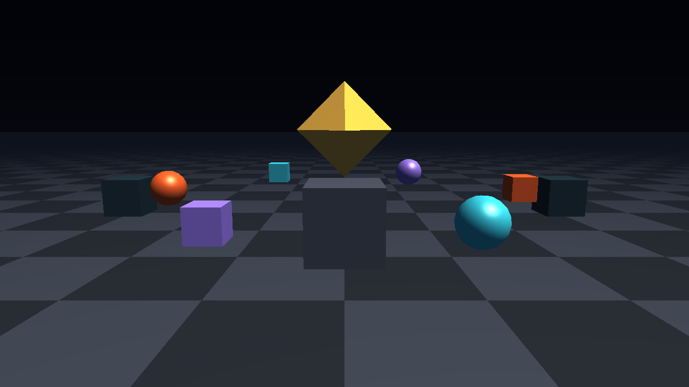

# Keystone

[](https://github.com/AegeanWorks/AIKit)



A performance-first 3D game engine in Python with an OpenGL 3.3 renderer, scene graph, OBJ assets and a headless-testable core.

Keystone is a small, readable engine rather than a framework wrapper: the math, scene graph, asset loader, GLSL programs and frame loop are all in this repository, and every layer is covered by tests. It renders on the GPU, boots a demo window in one command, and can render deterministic PNG frames without a visible window for CI and agents.

## ⚡ 30-Second Cold-Start Quick Reference

- **Runtime Prerequisites**: Python 3.10+ with the pinned `requirements.txt` stack (numpy 2.5.3, PyOpenGL 3.1.10, glfw 2.11.0, pytest 9.1.1) and an OpenGL 3.3-capable GPU driver.
- **Install**: `python -m pip install -r requirements.txt`
- **Canonical Regression Shield Gate**:
  ```bash
  python -m pytest -q
  ```
- **Run the demo window**:
  ```bash
  python -m keystone
  ```
- **Render a frame without a window**:
  ```bash
  python -m keystone --headless --frames 1 --size 1280x720 --out frame.png
  ```

### 🛠️ AIKit Commands (run from the AIKit folder)

| Role | Command |
|---|---|
| Status, task and gates | `python aikit.py status keystone` |
| Phase 4: every gate | `python aikit.py check keystone` |
| Repair memory and map, then check | `python aikit.py fix keystone` |
| Resume an interrupted task | `python aikit.py resume keystone` |

## 🎮 Controls

The demo captures the mouse on start.

| Input | Action |
|---|---|
| `W` / `A` / `S` / `D` | Move forward / left / back / right |
| `Q` / `E` | Move down / up |
| Mouse | Look around |
| Arrow keys | Look with the keyboard |
| `Shift` | Move faster |
| `F1` | Release or recapture the mouse |
| `Esc` | Close the window |

## 🚀 Features

- **GPU renderer**: OpenGL 3.3 core, GLSL 330, indexed `glDrawElements`, depth testing, back-face culling and a gradient sky pass.
- **Blinn-Phong lighting**: one directional light, ambient fill, specular highlights, distance fog and an optional world-space checker on any material.
- **Scene graph**: named nodes, parent/child transforms, world matrices, visibility inherited from ancestors and cycle-safe reparenting.
- **Perspective camera**: yaw/pitch orientation with pitch clamping, fly movement and `look_at`.
- **Math core**: immutable `Vec3`, column-major `Mat4` (OpenGL-ready flat upload), `Quat` rotation and slerp. No hidden global state.
- **Geometry**: indexed `MeshData`, cube / plane / UV-sphere primitives and a streaming Wavefront OBJ loader with UV, normal and negative-index support. Missing normals are synthesized per face.
- **Headless parity**: the same renderer runs in a hidden 64×64 context in tests and at 1280×720 for screenshots, with no display server dependency beyond GLFW.
- **Dependency-free PNG capture**: `keystone.png` writes RGBA screenshots with the standard library only.
- **Deterministic demo**: the same scene and animation run in a window or headless; `Demo.update(dt)` is the only animation source.

## 📈 Performance

Keystone submits geometry once per mesh (VBO/EBO) and only uniforms per frame; it never re-uploads vertex data while a mesh is cached. Depth testing and back-face culling are enabled globally, and the sky is one full-screen triangle.

A local headless run of 120 frames at 1280×720, including interpreter start, demo construction and GPU context creation, completed in about 1.0 s on an AMD Radeon RX 9060 XT (OpenGL 3.3 core, Python 3.14). That is a measurement of this demo, not a benchmark suite; the next expected bottleneck is Python draw submission for scenes with many thousands of objects.

## 📦 What's Inside

```text
keystone/
├── keystone/
│   ├── __init__.py           <- package surface and version
│   ├── __main__.py           <- CLI: window, headless frames, PNG output
│   ├── math3d.py             <- Vec3, Mat4, Quat (column-major, OpenGL-ready)
│   ├── camera.py             <- perspective camera and fly-style movement
│   ├── scene.py              <- hierarchy, transforms, light, sky and fog
│   ├── geometry.py           <- indexed mesh data and Blinn-Phong material
│   ├── primitives.py         <- cube, ground plane and UV sphere
│   ├── obj_loader.py         <- streaming Wavefront OBJ loader
│   ├── png.py                <- dependency-free PNG screenshot writer
│   ├── app.py                <- engine loop, input and screenshot capture
│   ├── demo.py               <- built-in animated demo scene
│   └── gpu/
│       ├── __init__.py       <- GPU adapter package marker
│       ├── context.py        <- GLFW window and OpenGL 3.3 context
│       ├── shader.py         <- GLSL compilation and uniform upload
│       ├── mesh_buffer.py    <- VAO/VBO/EBO upload and drawing
│       └── renderer.py       <- forward renderer, sky, depth, fog, readback
├── assets/
│   ├── octahedron.obj        <- sample OBJ asset
│   └── screenshot.png        <- generated demo frame
├── tests/
│   ├── test_math3d.py        <- unit tests for the math core
│   ├── test_scene.py         <- unit tests for hierarchy and camera
│   ├── test_geometry.py      <- unit tests for meshes, primitives and OBJ
│   ├── test_png.py           <- unit tests for the PNG writer
│   ├── test_renderer.py      <- headless OpenGL integration tests
│   └── test_app.py           <- engine loop, demo and CLI tests
├── requirements.txt          <- pinned runtime and test dependencies
├── pyproject.toml            <- package metadata and pytest configuration
├── .gitignore                <- transient AIKit state excluded
├── LICENSE                   <- Aegean License 1.1 (AL-1.1): free personal use
├── COMMERCIAL.md             <- Commercial licensing terms
├── LICENSES/                 <- REUSE license texts
├── REUSE.toml                <- Machine-readable SPDX metadata
├── README.md
└── .aikit/                   <- this project's memory: record, ledger, decisions
```

### Frame flow

```text
Engine.run
  -> poll GLFW events and resize the framebuffer
  -> read keyboard / captured mouse and move the camera
  -> Demo.update(dt): rotate the orbit ring, spin and bob the crystal
  -> Renderer.render(scene)
       -> clear color + depth
       -> sky pass (full-screen triangle, depth writes off)
       -> scene pass (one draw per visible MeshData, cached GPU buffers)
  -> swap buffers (visible window only)
```

## 🧩 Extending the Engine

Add any primitive or OBJ mesh to a scene with a transform and a material:

```python
from keystone.geometry import Material
from keystone.math3d import Vec3
from keystone.obj_loader import load_obj
from keystone.scene import Node, Scene, Transform

scene = Scene()
scene.camera.position = Vec3(0.0, 2.0, 6.0)
scene.camera.look_at(Vec3(0.0, 0.5, 0.0))
scene.add(
    Node(
        "artifact",
        Transform(position=Vec3(0.0, 0.8, 0.0), scale=Vec3(0.7, 0.7, 0.7)),
        mesh=load_obj("assets/octahedron.obj"),
        material=Material(color=Vec3(0.9, 0.7, 0.2), shininess=96.0),
    )
)
```

`MeshData` is immutable and GPU-ready: positions, normals, optional UVs and triangle indices. A node's `mesh` is uploaded once and cached by identity; change the transform every frame at no upload cost. Hidden ancestors skip the whole subtree during rendering.

## 🗺️ Roadmap

Keystone ships the vertical slice it set out to prove: GPU rasterization, scene hierarchy, assets, camera, lighting and headless capture. The next milestones, in order, are:

1. Shadow mapping and a second light type (point/spot).
2. PBR materials, sRGB/linear color management and texture loading.
3. Animation: skeletal skinning, morph targets and a timeline.
4. A scene format (JSON/glTF) and an asset hot-reload path.
5. An editor with gizmos and an inspector, plus an ECS for large scenes.

## 🤖 AIKit Integration

This project is a first-class AIKit project:

- `.aikit/project.json` declares `mechanics.core` (the headless engine paths) and `mechanics.test` (a one-frame headless render), so an agent and the UI exercise the same engine.
- `.aikit/task_ledger.json` records the plan, checkpoints and handoff state; resume with `python aikit.py resume keystone`.
- `.aikit/decisions.md` records architecture decisions (ADR-001..ADR-003).
- `python aikit.py check keystone` is the Phase 4 gate: tests, hygiene scan, guidelines and secret scan. It never pushes; delivery is opt-in.

The engine is intentionally host- and editor-agnostic: no AIKit imports exist inside `keystone/`, so it can be embedded in a game, a tool or another agent harness.

## 📜 License

Free for personal use under the Aegean License 1.1 (AL-1.1); see [LICENSE](LICENSE). Any commercial use needs the Aegean Commercial License 1.0 (ACL-1.0); see [COMMERCIAL.md](COMMERCIAL.md).
