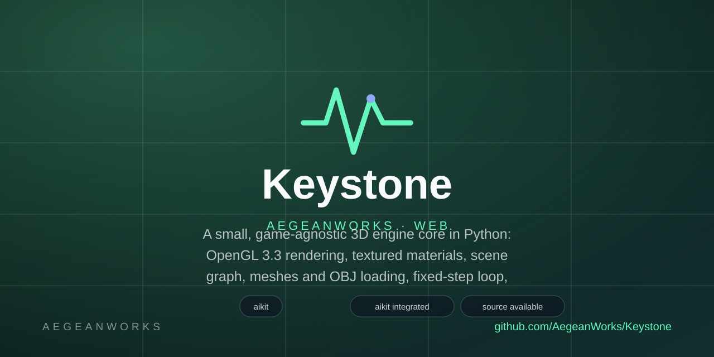
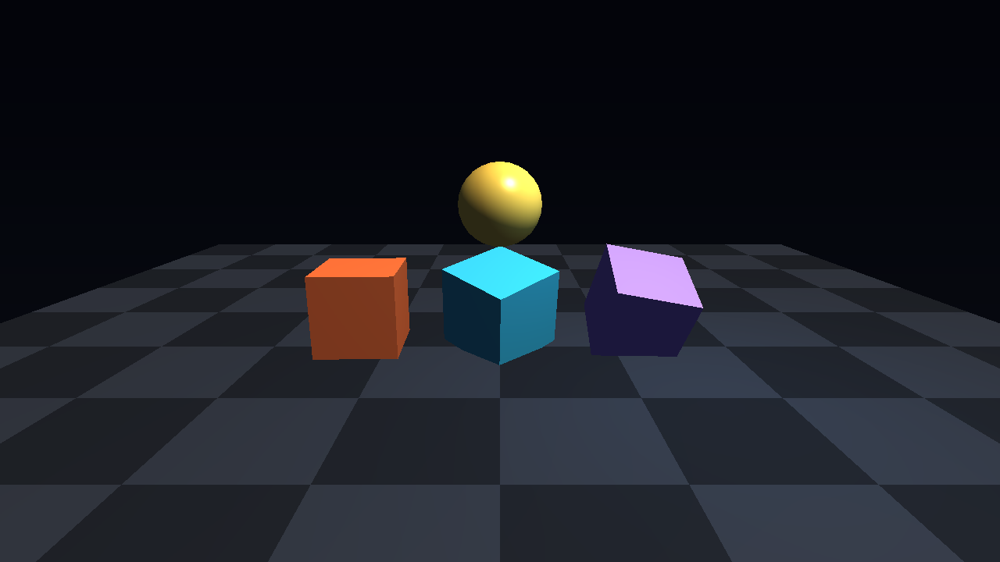
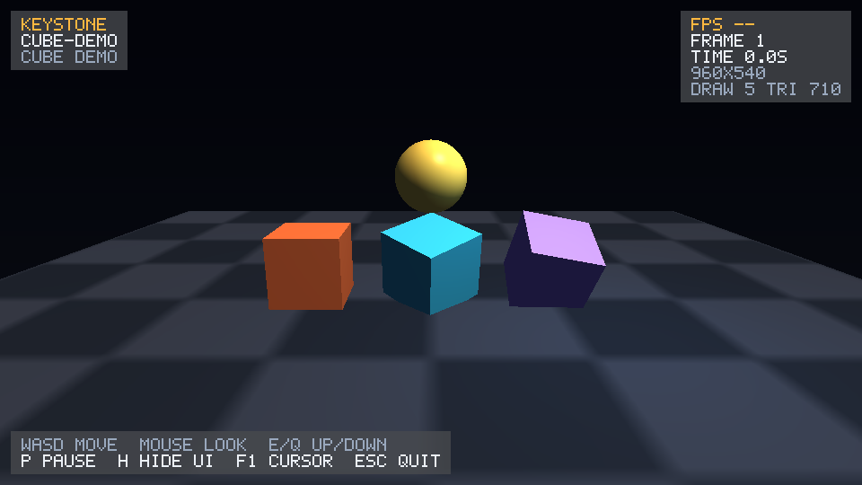
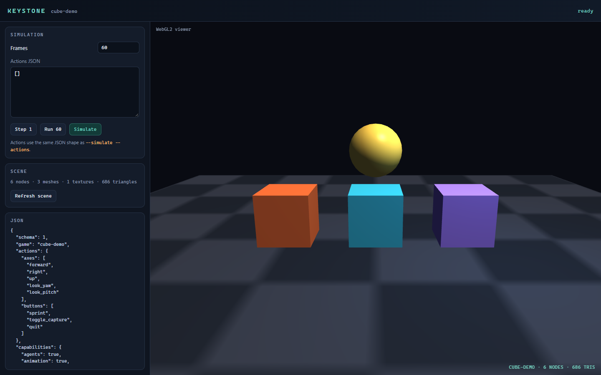

# Keystone

<!-- aegean:media:start -->
<p align="center"></p>
<p align="center"><a href="LICENSE"></a> <a href="https://github.com/AegeanWorks/AIKit"></a></p>
<!-- aegean:media:end -->




A game-agnostic 3D engine core in Python: OpenGL 3.3 PBR rendering, scene graph, meshes/OBJ, fixed-step loop, rebindable input, animation, particles, audio, collision, replay, atomic saves, batch merging and a HUD overlay.

Games plug in through one five-operation contract. Keystone ships a **cube demo** only as a smoke test; it contains no combat, puzzles, procedural worlds or genre rules. External games live outside this package and load with `--game package.module:Factory`. Games may add optional `draw_ui` and `bind_input` hooks.

## ⚡ 30-Second Cold-Start Quick Reference

- **Runtime Prerequisites**: Python 3.10+ with the pinned `requirements.txt` stack (numpy 2.5.3, PyOpenGL 3.1.10, glfw 2.11.0, pytest 9.1.1) and an OpenGL 3.3-capable GPU driver.
- **Install**: `python -m pip install -r requirements.txt`
- **Canonical Regression Shield Gate**:
  ```bash
  python -m pytest -q
  ```
- **Create and open a project**:
  ```bash
  python -m keystone --new my-game
  python -m keystone --project my-game
  ```
- **Package a project**:
  ```bash
  python -m keystone --project my-game --export build/my-game
  ```
- **Open the local web console and WebGL viewer**:
  ```bash
  python -m keystone --serve
  ```
- **Hide or disable the human overlay**:
  ```bash
  python -m keystone --no-ui
  ```
- **Render headlessly with the HUD**:
  ```bash
  python -m keystone --headless --frames 1 --size 960x540 --ui --out hud.png
  ```
- **Discover a game from an AI client**:
  ```bash
  python -m keystone --describe
  ```
- **Verify a scenario is deterministic**:
  ```bash
  python -m keystone --verify-determinism --frames 120
  ```
- **Pin a known result**:
  ```bash
  python -m keystone --simulate --frames 120 --expect-hash <32-hex-hash>
  ```
- **Simulate without OpenGL**:
  ```bash
  python -m keystone --simulate --frames 120 --trace
  ```
- **Emit a model-readable frame report**:
  ```bash
  python -m keystone --headless --frames 1 --size 1280x720 --out frame.png --report frame.json
  ```
### 🛠️ AIKit Commands (run from the AIKit folder)

| Role | Command |
|---|---|
| Status, task and gates | `python aikit.py status keystone` |
| Phase 4: every gate | `python aikit.py check keystone` |
| Repair memory and map, then check | `python aikit.py fix keystone` |
| Resume an interrupted task | `python aikit.py resume keystone` |

## 🧩 GameModule Contract

A game is an object with a name and five operations:

```python
from keystone.input import ActionState
from keystone.scene import Node, Scene


class MyGame:
    name = "my-game"

    def build_scene(self) -> Scene:
        scene = Scene()
        scene.add(Node("cube"))
        return scene

    def update(self, dt: float, actions: ActionState) -> None:
        ...

    def snapshot(self) -> dict[str, object]:
        return {"time": 0.0}

    def actions(self) -> dict[str, object]:
        return {"axes": ["forward", "right", "up", "look_yaw", "look_pitch"]}

    def status(self) -> str:
        return "my game"
```

The engine owns the window, OpenGL context, renderer, fixed clock, input sampling and screenshots. The game owns its state, rules and scene contents. The engine never imports a game.

### Optional live controls

A game may implement `bind_input(mapping)` to extend the engine's default
`InputMap` with its declared buttons:

```python
def bind_input(self, mapping: InputMap) -> None:
    mapping.bind("slot1", "1")
    mapping.bind("reload", "r")
```

The hook runs once after the engine builds its map. `describe_game()` reports
`capabilities.input_bind_hook` and `input_keys`; `Engine` exposes
`unbound_buttons` and `unknown_keys` so a dead control is visible. Mouse
buttons arrive through `ActionState.mouse_clicked`, not key bindings.

### Camera-relative content

`CameraRig(scene.camera)` keeps a scene root on the camera pose. `attach()`
adds parts with camera-space offsets (`+X` right, `+Y` up, `-Z` forward) on
the reserved `overlay` layer, and `sync()` follows the camera after it moves:

```python
rig = CameraRig(scene.camera)
rig.attach("viewmodel", position=Vec3(0.27, -0.21, -0.6), mesh=gun, material=metal)
rig.attach_to(scene)
# later, after camera movement and before a frame renders:
rig.sync()
```

The renderer draws the overlay layer after a depth clear, so level geometry
cannot occlude it, and world culling, batch plans, merges and shadows skip
it. `--describe` reports `capabilities.camera_rig` and `overlay_layer`.

### Scene identity and components

A node carries a stable scene ID, tags, one layer and optional typed components:

```python
from dataclasses import dataclass

from keystone.scene import Node, Scene


@dataclass(frozen=True)
class Health:
    value: int


scene = Scene()
hero = scene.add(Node("hero", id="hero", tags={"player"}, layer="actors"))
hero.add_component(Health(100))

assert scene.find_by_id("hero") is hero
assert scene.query(tag="player", layer="actors") == [hero]
assert scene.query(component=Health) == [hero]
```

IDs are allocated per scene (`node-1`, `node-2`, ...) on attach or first traversal. An explicit `id` is kept, a duplicate is rejected, and reparenting preserves it. `tags` are a set of strings, `layer` is one string, and each node holds one component per type. Queries are linear scans; an index can come later.

### Physics: broadphase, characters and triggers

```python
from keystone.broadphase import SpatialGrid
from keystone.character import CharacterBody, CharacterController
from keystone.math3d import Vec3
from keystone.physics import AABB, Ray, raycast
from keystone.triggers import TriggerTracker, TriggerVolume

grid = SpatialGrid(cell_size=4.0)
wall = AABB(Vec3(0, 0, 0), Vec3(0.5, 2, 4))
grid.insert("wall", wall)
boxes = [grid.get(key) for key in grid.query(AABB(Vec3(0, 0, 0), Vec3(1, 1, 1)))]
controller = CharacterController()
body = controller.step(
    CharacterBody(Vec3(0, 1, 0)),
    Vec3(4, 0, 0),
    1 / 60,
    [box for box in boxes if box is not None],
)
events = TriggerTracker().update(body.box(), [TriggerVolume("door", AABB(Vec3(0, 1, 0), Vec3(1, 1, 1)))])
hit = raycast(Ray(Vec3(), Vec3(0, 0, 1)), [("wall", wall)])
```

`SpatialGrid` keeps a uniform grid of AABB proxies with exact overlaps in insertion order; `cell_size` trades speed, not correctness. `CharacterController` moves an AABB body with wish velocity, gravity, wall/floor response, stair step-up, slope-limited climb and platform carry; no capsules or solvers. `TriggerTracker` reports sorted `entered`/`exited` tuples and an immutable `active` set; `raycast()` returns the nearest hit.

### Pathfinding: deterministic A*

```python
from keystone.pathfinding import NavGrid, find_path, path_report

grid = NavGrid(32, 24, frozenset({(5, y) for y in range(12)}))
result = find_path(grid, (0, 0), (20, 10), diagonal=True)
print(path_report(result))
```

`NavGrid` is an immutable bounded grid with blocked cells. `find_path()` runs A* over four or eight neighbours, refuses to cut wall corners on diagonal moves, and returns a deterministic `PathResult` (`path`, `cost`, `expanded`, `found`); a blocked start or an out-of-bounds endpoint raises, and an unreachable goal returns `found=False`. `line_of_sight()` tests a straight segment cell by cell with the same corner rule, and `smooth_path()` greedily drops waypoints whose straight replacement stays visible, so a follower gets a short route without cutting corners. `path_report()` gives a JSON-safe route summary for agent and capture evidence. `--describe` reports `capabilities.pathfinding` and `capabilities.path_smoothing`.

### Nav grids from level boxes

```python
from keystone.nav_authoring import grid_from_boxes, write_navgrid

grid = grid_from_boxes(48, 32, wall_boxes, cell_size=1.0, clearance=0.4)
write_navgrid("levels/hall.navgrid", grid)
```

The editor's `bake_navgrid` action derives a grid from the current scene's visible meshes (optional layer, clearance and origin) and returns the schema-1 document; `inspect_navgrid` validates a document and reports counts; `route_navgrid` runs A* between two cells, optionally with diagonals and smoothing, and returns both the raw and smoothed route; `trace_navgrid` walks a fresh `NavAgent` from a start cell toward a goal with a fixed step budget and reports whether it arrived, how many steps it took and its final body state. `grid_from_boxes()` rasterizes the same AABBs a character collides with: a cell blocks when its world-space centre falls inside a box inflated by the clearance radius on X and Z, so navigation cannot silently drift from the level geometry. `scene_boxes()` derives those AABBs from a scene's visible mesh nodes (skipping the camera-relative overlay layer), so one level can feed the grid directly. `NavGrid.to_dict()`/`from_dict()` and `write_navgrid`/`read_navgrid` persist a schema-1 document that sorts blocked cells, rejects duplicates and rejects out-of-bounds cells. `--describe` reports `capabilities.nav_authoring`.

### Post grade and tonemapping

```python
from keystone.scene import PostSettings

scene.post = PostSettings(enabled=True, tone="aces", anti_alias="fxaa")
```

The post grade applies `scene.post.exposure` and `scene.post.vignette` after bloom. `tone` optionally maps the linear colour through Reinhard (`c / (1 + c)`) or the ACES approximation before the grade, which keeps bright emissive surfaces from clipping to white. The default is `none`, so existing frames are unchanged. Defaults are 1.12 and 0.28, so existing frames stay unchanged. `anti_alias` accepts `none` or `fxaa`; FXAA runs as a full-screen pass over the rendered frame and leaves a uniform frame byte-identical. `scene.post` round-trips through snapshots, the editor's `set_scene` accepts `environment.tone`, `environment.exposure`, `environment.vignette` and `environment.anti_alias` (editor schema 62, scene export schema 5), and renderer stats report `post_tone`, `post_exposure`, `post_vignette` and `post_aa`. `--describe` reports `capabilities.post_tonemap`.

### Tile maps

```python
from keystone.tilemap import TileMap, tilemap_report

tiles = TileMap(16, 12, tile_size=2.0, solid={(3, y) for y in range(6)})
scene.add(Node("level", mesh=tiles.mesh(), material=Material()))
walls = tiles.colliders()  # feed to physics, nav_authoring or picking
```

`TileMap` is an immutable grid with one wall height. The editor's `inspect_tilemap` action reports a document's counts and bounds, and `build_tilemap` applies its merged mesh to a scene node through undo history. `colliders()` returns one exact `AABB` per solid cell (x-major order) for `raycast`, `CharacterController` or `grid_from_boxes`; `mesh()` merges a floor quad per free cell and a wall box per solid cell into one `MeshData`, colored by the map's floor and wall colors; `with_cell()` returns a modified copy. `to_dict()`/`from_dict()` persist a schema-1 document, and `tilemap_report()` emits counts and world bounds for agent logs. `--describe` reports `capabilities.tilemap`.

### Scene picking

```python
from keystone.picking import hit_report, raycast_scene

hit = raycast_scene(scene, Ray(camera.position, camera.forward()))
print(hit_report(hit))
```

`raycast_scene()` returns the nearest visible mesh under a ray as a `SceneHit` with the node id, node name, world distance and contact point. Hidden nodes, camera-relative overlay content, an excluded layer and ignored ids or names never block the query, and bounds are the same conservative mesh AABBs navigation uses. `overlap_scene()` is the area counterpart: pass a `Sphere` or `AABB` and get every overlapping visible mesh, sorted by centre distance then node id, with the same filters. `hit_report()` and `overlap_report()` emit JSON-safe results for agent logs and evidence. `--describe` reports `capabilities.scene_raycast` and `capabilities.scene_overlap`.

### Navigation: following a route

```python
from keystone.navigation import PathFollower, grid_path_points, navigation_report

points = grid_path_points(result.path, cell_size=1.0, height=0.9)
follower = PathFollower(points, speed=3.0)
wish, done = follower.advance(body.position)
body = controller.step(body, wish, 1 / 60, walls)
```

`PathFollower` turns waypoints into a wish velocity for `CharacterController`. It advances by the position the caller reports back, so a wall that holds the body in place keeps the follower aimed at the same waypoint instead of skipping it; the next waypoint is the first one farther than `arrive_radius`, and a consumed route reports `done` forever. `navigation_report()` emits JSON-safe follower state, and `--describe` reports `capabilities.navigation`.

### Steering and avoidance

```python
from keystone.steering import Agent, seek, steer

agent = Agent(position=Vec3(0.0, 0.0, 0.0), radius=0.4, max_speed=3.0)
wish = seek(agent.position, target, agent.max_speed)
adjusted = steer(agent, wish, other_agents, separation_weight=1.2)
```

`seek()` and `arrive()` turn a target into a wish velocity; `separation()` sums a quadratic repulsion from neighbours inside their contact radius; `steer()` combines a wish with that repulsion and clamps to the agent's max speed, ignoring the agent itself by identity. `steering_report()` emits a JSON-safe wish summary for agent logs. No function integrates time or owns state, so a game keeps collision response in charge. `--describe` reports `capabilities.steering`.

### Nav agents

```python
from keystone.nav_agent import NavAgent

agent = NavAgent(grid, CharacterController(), body, speed=3.0)
agent.set_goal((12, 4))
for _ in range(600):
    report = agent.step(1.0 / 60.0, walls, other_agents)
    if report["done"]:
        break
```

`NavAgent` composes the whole stack: A*, smoothing, `grid_path_points`, `PathFollower`, separation steering and `CharacterController`. `set_goal()` plans once and returns False for an unreachable goal; `replan()` re-runs after a grid change; `step()` moves the body against colliders, optionally avoids neighbouring agents, and returns a JSON-safe report with position, velocity, ground state and route progress. The agent owns its body but not a scene node, so a game decides which node follows it. `--describe` reports `capabilities.nav_agent`.

### Audio: distance attenuation

```python
from keystone.audio_spatial import SoundSource, spatial_mix, spatial_report

source = SoundSource(position=Vec3(4.0, 0.0, 2.0), clip=beep, min_distance=1.0, max_distance=20.0)
mix = spatial_mix(listener.position, [source], bus_gains={"sfx": 0.8})
print(spatial_report(listener.position, [source]))
```

`distance_gain()` is linear: full volume inside `min_distance`, silent at `max_distance`, interpolated between. `spatial_mix()` sends every source through the named-bus `Mixer` with attenuation baked into its voice gain, so clip length, pitch and clipping match the rest of the audio core. `spatial_report()` emits JSON-safe per-source distance, attenuation, bus and audibility. Clips are mono, so this attenuates by distance without panning. `--describe` reports `capabilities.spatial_audio`.

### Optional game UI

A game may add a `draw_ui(canvas, state)` method. It is optional; the five required operations do not change.

```python
from keystone.ui import Canvas, HudState


def draw_ui(self, canvas: Canvas, state: HudState) -> None:
    canvas.rect(16, 96, 220, 44, (0.03, 0.04, 0.06, 0.7))
    canvas.text(28, 108, f"OBJECTS {len(self.objects)}", (0.92, 0.94, 0.97, 1.0))
```

The hook runs before the engine HUD and pause menu, so engine UI stays on top. It receives the current `Canvas` and `HudState`, so games share the embedded font, clipping and pause state. `H` hides game UI too.

`canvas.paragraph(x, y, width, text, color, scale)` wraps at word boundaries, preserves explicit newlines and blank lines, truncates a single overlong word and returns the height used; `canvas.image()` draws a clipped textured quad with UV subrects, tint and alpha. `--describe` reports `capabilities.ui_text_wrap` and `capabilities.ui_images`.

### Deterministic randomness

```python
from keystone.rng import RandomStream

rng = RandomStream(seed=1337)
enemies = rng.fork("enemies")
position = Vec3(rng.uniform(-4.0, 4.0), 0.0, rng.uniform(-4.0, 4.0))
```

`RandomStream` implements SplitMix64 with a pinned reference vector, so a replay or save resumes the same sequence on every platform. `random()`, `uniform()`, `randint()` (inclusive, no modulo bias), `choice()` and `shuffled()` cover normal needs; `fork(label)` derives an independent child stream for a subsystem; `snapshot()`/`from_snapshot()` persist the seed and state for saves. `--describe` reports `capabilities.deterministic_random`.

### Textures

```python
from keystone.geometry import Material
from keystone.math3d import Vec3
from keystone.texture import TextureData

material = Material(
    color=Vec3(1.0, 1.0, 1.0),
    texture=TextureData.from_png("assets/floor.png"),
)
```

`TextureData.from_png()` accepts the same 8-bit RGBA PNGs as the reader. `TextureData.checker(size, dark, light, cell)` builds a deterministic texture without a file, and `TextureData.pattern(...)` adds seeded cell/grid/panel/rivets/noise presets. Textures use repeat wrapping, mipmaps and mesh UVs; the renderer caches one GPU texture per immutable payload.

## 🕹️ Sample Controls

The bundled `CubeDemo` uses the generic action map; the overlay shows it at runtime:

| Input | Action |
|---|---|
| `W` / `S` | Forward / back |
| `A` / `D` | Left / right |
| `E` / `Q` | Up / down |
| Mouse | Look; click menu items while paused |
| Arrow keys | Keyboard look |
| `P` | Pause / resume; opens the menu and releases the cursor |
| `W` / `S` or `↑` / `↓` | Move the pause-menu selection |
| `Enter` | Confirm the selected pause-menu item |
| `H` | Hide / show the HUD and help |
| `F1` | Release / recapture the mouse |
| `Esc` | Quit |

Pausing stops `GameModule.update()` while the window, renderer and overlay stay responsive. The pause menu offers `Resume`, `Hide HUD` and `Quit`; the cursor is released while it is open and recaptured on resume. The overlay never changes game state.

## 🖥️ Human UI

Windowed runs draw a HUD by default; `--no-ui` turns it off and `--ui` adds it to a headless capture:

```bash
python -m keystone --no-ui
python -m keystone --headless --frames 1 --size 960x540 --ui --out hud.png --report hud.json
python -m keystone --headless --frames 1 --size 960x540 --ui --start-paused \
  --out paused.png --report paused.json
```

`--start-paused` renders the pause menu immediately, which is useful for UI screenshots and AI UI reports.

The overlay contains:

- game name, game status, FPS, frame number, elapsed simulation time and resolution;
- a controls panel (`P` pause, `H` hide, `F1` cursor, `Esc` quit);
- an interactive pause menu with `Resume`, `Hide HUD` and `Quit`, navigable by keyboard or mouse;
- a centered pause banner.

`keystone.ui` splits into an embedded 5×7 font, a clipped `Canvas` (with `text_width`/`text_right`/`fit_text`), panel/button widgets, a pure `PauseMenu` state machine and `HumanOverlay`; `keystone.gpu.ui_renderer` uploads the canvas as one alpha-blended draw call. A game's optional `draw_ui(canvas, state)` hook draws into the same canvas, so a headless `--ui` report measures what a person sees.

## 🌐 Web Console, JSON API and WebGL Viewer

```bash
python -m keystone --serve
python -m keystone --serve --port 8899 --game package.module:Factory
```

The console binds to `127.0.0.1:8000` and serves a browser dashboard plus the same AI-facing JSON as the CLI. It uses only the standard library and vanilla JavaScript: no npm build, CDN or extra runtime dependency.

The dashboard can inspect the game contract, run the same action scripts as `--simulate`, refresh the live scene, and preview it in a WebGL2 viewer with textures, vertex colors, lights and fog. The browser viewer is approximate; the OpenGL renderer remains the pixel authority.

| Endpoint | Method | Purpose |
|---|---|---|
| `/api/health` | `GET` | server, game and schema versions |
| `/api/describe` | `GET` | the same discovery payload as `--describe`, including `capabilities.web` |
| `/api/scene` | `GET` | scene document schema 2: camera, lights, atmosphere, node identity, world matrices, shared meshes and RGBA textures |
| `/api/inspector` | `GET` | batch plan, merge, audio/anim/particles, assets |
| `/api/editor` | `GET/POST` | scene editor document and actions: hierarchy, selection, transforms, prefabs, assets, animation and 1D/2D blend-space previews, tile-map inspect/build, and nav-grid inspect/bake/route/trace |
| `/api/simulate` | `POST` | the same deterministic result as `--simulate`; body `{"frames": 60, "actions": [...], "step": 0.0167, "trace": false}` |
| `/api` | `GET` | endpoint and schema index |

`POST /api/editor` takes `{"action": ..., ...}`; `preview_blend_space` and `preview_blend_space2d` apply a sampled pose from a 1D or 2D space and record it in editor history unless `record` is false.

The API sends CORS headers so local AI clients can call it directly. Keep the default loopback host; pass `--host 0.0.0.0` for deliberate exposure. The server never opens a GL context.

`/api/scene` exports the game's `self.scene` when it has one, so a live simulation is visible immediately. A game without that attribute gets a fresh `build_scene()` result; put the scene on `self.scene` for live state.

## 🚀 Features

- **OpenGL 3.3 renderer**: GLSL 330, PBR, shadows, sRGB, post grade with configurable exposure/vignette, optional Reinhard/ACES tonemapping and FXAA, bloom, placed sprite billboards, up to 8 point lights, and profiler stats.
- **Scene graph**: stable IDs, tags, layers, typed components, world transforms, queries, merged tile-map meshes with exact per-cell colliders, and cached GPU meshes.
- **Prefabs**: capture, versioned `.kprefab` persistence, deterministic instantiation and override-preserving refresh.
- **Assets**: `MeshData`, primitives, streaming OBJ, PNG/checker `TextureData`, and an id/digest registry with hot reload plus core scene rebinding.
- **PBR materials**: specular/shininess plus metallic/roughness/emissive, wrapped/mipmapped textures and material graphs.
- **Runtime**: fixed-step clock with bounded catch-up; headless one-step-per-frame determinism.
- **Input**: rebindable `InputMap` across contexts, a game `bind_input` hook, and dead-binding diagnostics.
- **Audio**: synth, named-bus mixer, deterministic mixdown, WAV I/O, distance-attenuated spatial mixes and reports; no hardware output.
- **Animation**: tracks/clips, looping, crossfades, events, 1D and bilinear 2D blend spaces, state machines that drive either space, masked `apply_pose`, clip binding onto pooled nodes, root-motion extraction and a looping player, CPU/GPU skinning and state machines.
- **Particles and physics**: seeded emitters with swept collision; rays, AABB/sphere queries, broadphase, scene picking, character movement and triggers.
- **Pathfinding**: immutable nav grids, deterministic A* over 4 or 8 neighbours with corner-cut refusal, line-of-sight path smoothing, JSON-safe path reports, scene/box-derived nav grids with schema-1 documents, a waypoint follower, seek/arrive/separation steering, and a composed nav agent that walks a route with collision and avoidance.
- **Replay and determinism**: command logs, stable hashes, `run_log`/`verify_log`, atomic JSON with `.bak`, and SplitMix64 random streams with labelled forks and snapshot/restore.
- **Testing and AI**: `--describe`, `--simulate`, `--verify-determinism`, `--expect-hash`, frame reports, pixel diffs, seeded playtests, deterministic capture routes with checkpoint evidence diffs, and adapters.
- **Human UI and web**: overlay/pause menu, `draw_ui`, measured-text layout widgets (`label_row`, `table`, `progress_bar`, `badge`), textured HUD images, stdlib JSON API and WebGL2 console/editor.
- **Game-agnostic core**: no combat, light-lock, weave or expedition code.

## 🤖 AI Testing & Frame Analysis

### Discover the game contract

```bash
python -m keystone --describe
```

Includes game name, actions, snapshot and 32 capability keys.

### Verify determinism and visual regressions

```bash
python -m keystone --verify-determinism --frames 120 --actions actions.json
python -m keystone --headless --frames 1 --size 1280x720 \
  --out frame.png --report current.json --compare-baseline baseline.json
```

The first command runs the scenario twice and exits 0 only when both hashes match. The second renders, writes the report, compares it with the baseline and exits non-zero when the image changed. The diff covers luminance/content deltas and added/removed/changed nodes. `--diff-out diff.png` adds a visual pixel diff. `--expect-hash <32-hex>` pins a known final hash either way.

See [`docs/AI_GUIDE.md`](docs/AI_GUIDE.md) for the complete workflow.

### Simulate without a GPU

`--simulate` imports the game and applies actions in fixed 1/60 s steps. It never creates an `Engine`, GLFW window or OpenGL context.

```bash
python -m keystone --simulate --frames 3 --actions actions.json --trace
```

`actions.json` is a list of `ActionState` objects (one per frame, or fewer repeated):

```json
[
  {"forward": 1.0, "look_yaw": 0.1},
  {"forward": 0.0, "pressed": ["toggle_capture"]}
]
```

The JSON result includes the game name, frames, step, actions used, final snapshot and a stable hash. `--trace` adds one snapshot per frame. `--out run.json` writes the result atomically.

For assertions in Python, use `keystone.testing`:

```python
from keystone.input import ActionState
from keystone.samples import CubeDemo
from keystone.testing import assert_deterministic, run_script

result = run_script(CubeDemo(), [ActionState(forward=1.0)], frames=120)
assert_deterministic(lambda: CubeDemo(), [ActionState(forward=1.0)], frames=120)
```

### Bot-playtest a game

```bash
python -m keystone --playtest --policy random --seed 7 --frames 120 --out report.json
```

Seeded `random`/`greedy`/`scripted` bots play headlessly through the five operations; `--expect-hash` pins the transcript, and an `unfair` configuration exits 1 with reasons.

### Analyze a rendered frame

`--report` writes a versioned JSON report next to the PNG:

```bash
python -m keystone --headless --frames 1 --size 1280x720 \
  --out frame.png --report frame.json
```

The report contains:

- `schema`, report field schema and a stable report `hash`;
- image path, dimensions, PNG and RGBA SHA-256, plus an optional pixel-diff summary;
- mean RGB/luminance, content box/ratio, dominant colors, 8×8 grid;
- camera plus per-node world/screen box, visibility and triangles;
- material color/specular/shininess/checker plus texture metadata;
- when `--ui` is active: `ui.visible`, `ui.paused`, every label's text/position/scale/color and every button's label, action, rect, selection and hover state. `ui` is `null` for clean captures.

AI clients diff frames/scenes/sim/UI via `compare_reports(before, after)` (image/report equality, stat/node/label deltas; no visual-quality claim).

## 📦 What's Inside

```text
keystone/
├── keystone/                <- engine package: runtime, scene, renderer, AI adapters
├── tests/                   <- unit suites and headless OpenGL integration suites
├── docs/                    <- architecture, AI guide, implicit-state audit, full tree
├── assets/                  <- brand and sample assets
├── LICENSES/                <- REUSE license texts
├── .aikit/                  <- project memory: guidelines, ledger, decisions
├── .gitignore               <- transient AIKit state excluded
├── CHANGELOG.md             <- release history
├── COMMERCIAL.md            <- commercial licensing terms
├── LICENSE                  <- Aegean License 1.1 (AL-1.1)
├── pyproject.toml           <- project metadata, lint and test configuration
├── README.md
├── requirements.txt         <- pinned runtime dependencies
└── REUSE.toml               <- machine-readable SPDX metadata
```

The README keeps this condensed map for orientation; the full annotated tree,
down to every source and test module, lives in [docs/TREE.md](docs/TREE.md).

## 🏗️ Architecture

The engine core is layered so games depend on it, never the reverse:

```text
GameModule (external)
  -> update(dt, ActionState)
  -> build_scene() -> Scene
Engine
  -> GLContext / InputMap / FixedStepClock
  -> Renderer.render(scene)
  -> UiRenderer.draw(HumanOverlay.build(state))
```

- `keystone.*` uses stdlib plus declared deps only.
- Games use the public API and never reach into another game.
- `GameModule` is a five-method Protocol; `ActionState`/`HudState` are frozen DTOs.
- `CommandLog`/`stable_hash()` fingerprint deterministic frames; `write_json_atomic()` uses temp+fsync+replace.

See [`docs/ARCHITECTURE.md`](docs/ARCHITECTURE.md) for dependency rules and roadmap; [`docs/IMPLICIT_STATE_AUDIT.md`](docs/IMPLICIT_STATE_AUDIT.md) records the state-machine audit.

## 📦 Asset Registry and Hot Reload

Keystone keeps meshes, materials and textures in a caller-owned `AssetRegistry`:

```python
from keystone.assets import AssetRegistry
assets = AssetRegistry()
assets.register_file("texture.logo", "assets/logo.png")
assets.refresh()  # sync reload; keeps last good payload on failure
```

Each asset has a stable id, kind, digest and dependencies. `refresh()` returns a `ReloadReport` (reloaded/unchanged/failed/missing) without crashing; it is synchronous with no thread.

## 🧱 glTF and GLB Import

`load_gltf()` accepts a `.gltf`/`.glb` path, JSON text or a parsed document:

```python
from keystone.gltf import load_gltf
imported = load_gltf("assets/robot.glb", registry=assets)
```

It decodes external/base64/GLB buffers, typed accessors, indexed triangles, PBR materials, PNG textures and TRS/matrix hierarchies. Bad modes/offsets/cycles raise.

## 💾 Scene Snapshots and Undo/Redo

`scene_to_dict()`/`scene_from_dict()` round-trip versioned snapshots (camera, environment, hierarchy, metadata, asset ids). Bad ids/parents/kinds/cycles are rejected.

```python
from keystone.history import History
from keystone.scene_snapshot import scene_from_dict, scene_to_dict

history = History(capacity=32)
history.push(scene_to_dict(scene))
snapshot = history.undo()
```

`History` deep-copies snapshots; schema 6 persists prefab-instance baselines; schema 1-5 stay compatible.

## 🗺️ Core Roadmap

Scene identity, physics, assets, PBR, batching, animation, particles, replay and AI adapters shipped through v0.45.0; the remaining renderer work is the full post chain, and editor hooks continue.

Games are external modules; they are not added to this repository.

## 🧪 Verification

```bash
python -m pytest -q
python -m keystone --simulate --frames 1
python -m keystone --headless --frames 1 --size 64x48
python aikit.py check keystone --strict
```

The project gate covers tests, lint, mechanics, hygiene, guidelines and secrets.

<!-- aegean:brand-assets:start -->
## 🎨 Brand Assets

> **AI-Generated Brand Artwork.** The banner and logo are **AI-generated brand assets**. They are illustrative and may not literally depict every feature or the full project scope.
<!-- aegean:brand-assets:end -->

## 📜 License

Free for personal use under the Aegean License 1.1 (AL-1.1); see [LICENSE](LICENSE). Any commercial use needs the Aegean Commercial License 1.0 (ACL-1.0); see [COMMERCIAL.md](COMMERCIAL.md).

<!-- aegean:screenshots:start -->
## Screenshots

<a href="https://github.com/AegeanWorks/Keystone/commit/e6c6318"></a>

<a href="https://github.com/AegeanWorks/Keystone/commit/e6c6318"></a>

*`e6c6318` · 2026-11-03 · 960x540 headless + 1440x900 console; `engine.png` is legacy art*
<!-- aegean:screenshots:end -->
